<div align="center">

<picture>
  <source media="(prefers-color-scheme: dark)" srcset="docs/assets/zuri-banner-escuro.svg">
  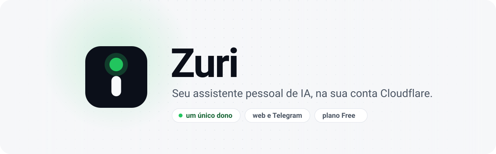
</picture>

<br>

[](https://github.com/pablopfg/Zuri/actions/workflows/ci.yml?query=branch%3Adevelop)
[](https://github.com/pablopfg/Zuri/actions/workflows/codeql.yml?query=branch%3Adevelop)
[](https://github.com/pablopfg/Zuri/releases)
[](LICENSE)
[](https://developers.cloudflare.com/workers/)
[](#-plano-free-sem-surpresa-na-fatura)
[](#️-mapa-das-etapas)
[](#-segurança-e-privacidade)
[](.nvmrc)

**Um assistente de IA que é só seu.** Ele roda num único Worker da sua conta Cloudflare, guarda tudo no SQLite<br>
de um Durable Object e conversa com você pelo navegador e pelo Telegram.

[Telas](#-telas) · [O que já funciona](#-o-que-já-funciona) · [Como funciona](#-como-funciona) · [Mapa das etapas](#️-mapa-das-etapas) · [Rodar localmente](#-rodar-localmente) · [Contribuir](CONTRIBUTING.md)

</div>

> [!NOTE]
> **Em construção.** A Zuri sai em 35 etapas, uma por PR, a partir da [especificação](docs/especificacao.md).
> As etapas 0 a 20 estão na `develop`,
> da conversa com o agente às automações, à central de avisos e ao bot do Telegram, que já manda avisos, conversa por texto e voz, responde a comandos rápidos sem IA, trava a leitura depois de horas sem uso, aprova as propostas da Zuri com passkey ou código por e-mail e liga o modo de bloqueio numa emergência; o n8n e outros programas falam com ela por tokens com escopo. O [mapa das etapas](#️-mapa-das-etapas) mostra o que já existe e o que vem a seguir; o estado detalhado fica em [`progresso.md`](.claude/memoria/progresso.md).

## Sumário

- [Por que a Zuri](#-por-que-a-zuri)
- [Telas](#-telas)
- [O que já funciona](#-o-que-já-funciona)
- [O que vem a seguir](#-o-que-vem-a-seguir)
- [Como funciona](#-como-funciona)
- [Segurança e privacidade](#-segurança-e-privacidade)
- [Plano Free, sem surpresa na fatura](#-plano-free-sem-surpresa-na-fatura)
- [Mapa das etapas](#️-mapa-das-etapas)
- [Rodar localmente](#-rodar-localmente)
- [Qualidade](#-qualidade)
- [Estrutura do repositório](#-estrutura-do-repositório)
- [Documentação](#-documentação)
- [Como contribuir](#-como-contribuir)
- [In English](#-in-english)
- [Créditos e licença](#-créditos-e-licença)

## 💡 Por que a Zuri

Cada pessoa publica a própria Zuri na própria conta Cloudflare, e ela atende só essa pessoa. Conversas, memórias e tarefas não passam pelo servidor de outra empresa.

- **Seus dados ficam com você.** Tudo mora no SQLite de um Durable Object da sua conta. Não há banco externo nem servidor de terceiros.
- **Custo zero.** Foi desenhado para caber no plano Free da Cloudflare, com contadores e tetos para a IA não passar da cota.
- **Segurança.** Turnstile em todo login, 2FA, passkeys, página de acessos e um agente que não tem shell, não roda código e só sai para a internet pelos serviços MCP que você ligar.
- **Web e Telegram.** A interface web (PWA) já está no ar; o bot do Telegram chega na fase C e passa pelos mesmos portões, com os mesmos dados.

## 📸 Telas

As capturas abaixo acompanham o tema do seu GitHub (claro ou escuro) e saem da `develop` com dados de exemplo.

<p align="center">
  <picture>
    <source media="(prefers-color-scheme: dark)" srcset="docs/capturas/conversa-computador-escuro.png">
    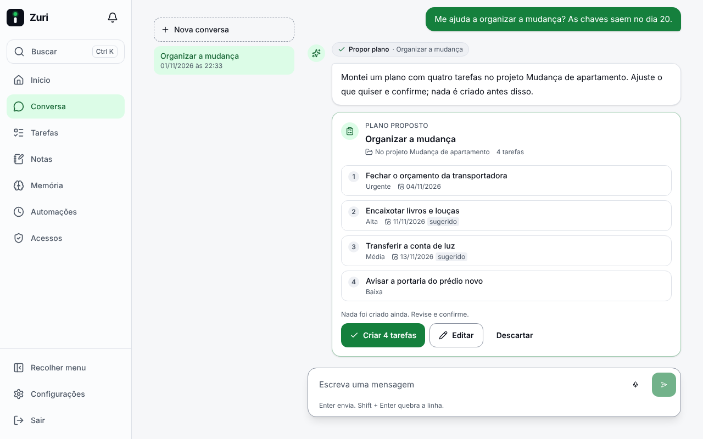
  </picture>
</p>
<p align="center"><b>Conversa</b>: a Zuri propõe, você confere e confirma</p>

<table>
  <tr>
    <td width="50%" valign="top">
      <picture>
        <source media="(prefers-color-scheme: dark)" srcset="docs/capturas/inicio-computador-escuro.png">
        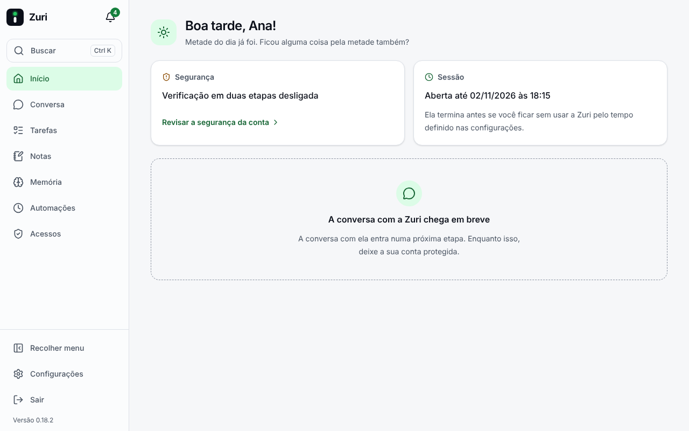
      </picture>
      <p align="center"><b>Início</b>: cumprimento pelo horário, segurança da conta e sessão num relance</p>
    </td>
    <td width="50%" valign="top">
      <picture>
        <source media="(prefers-color-scheme: dark)" srcset="docs/capturas/tarefas-computador-escuro.png">
        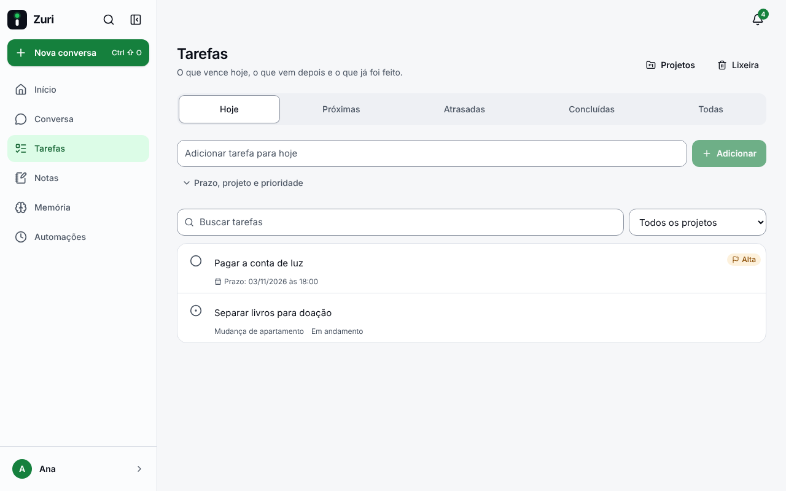
      </picture>
      <p align="center"><b>Tarefas</b>: hoje, próximas, atrasadas, projetos e lixeira</p>
    </td>
  </tr>
  <tr>
    <td width="50%" valign="top">
      <picture>
        <source media="(prefers-color-scheme: dark)" srcset="docs/capturas/nota-computador-escuro.png">
        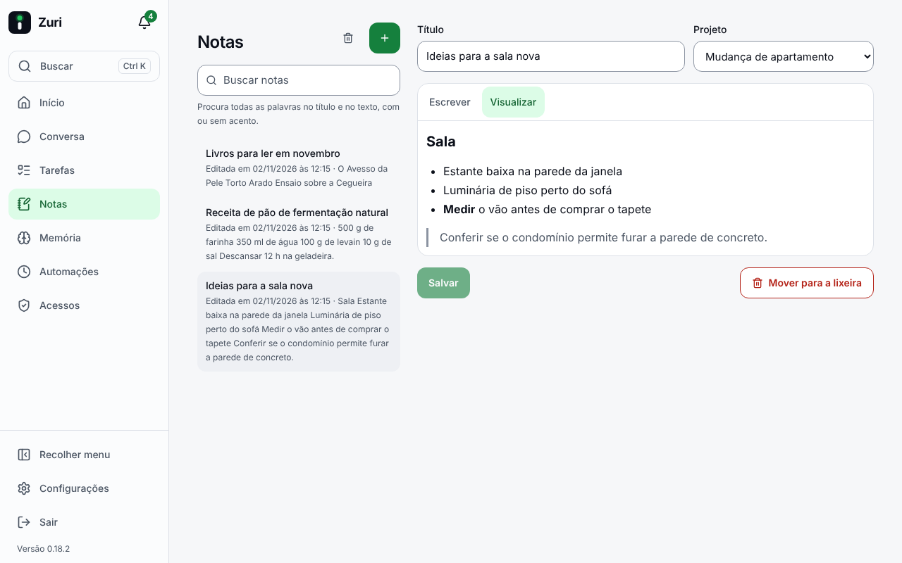
      </picture>
      <p align="center"><b>Notas</b>: Markdown, busca sem acento e projetos</p>
    </td>
    <td width="50%" valign="top">
      <picture>
        <source media="(prefers-color-scheme: dark)" srcset="docs/capturas/memoria-computador-escuro.png">
        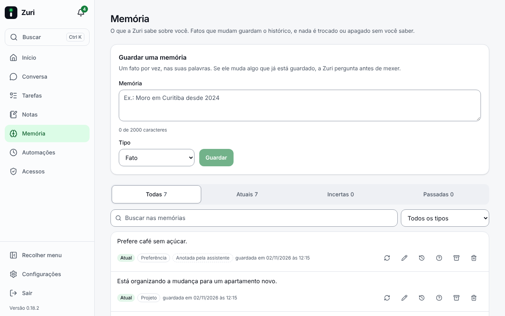
      </picture>
      <p align="center"><b>Memória</b>: o que a Zuri sabe, com histórico</p>
    </td>
  </tr>
  <tr>
    <td width="50%" valign="top">
      <picture>
        <source media="(prefers-color-scheme: dark)" srcset="docs/capturas/entrar-computador-escuro.png">
        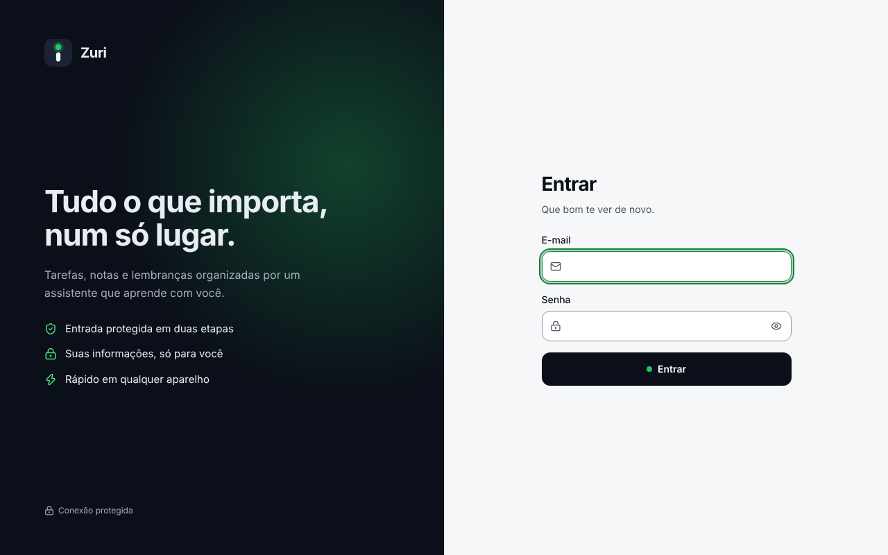
      </picture>
      <p align="center"><b>Entrar</b>: senha, verificação discreta e segundo passo</p>
    </td>
    <td width="50%" valign="top">
      <picture>
        <source media="(prefers-color-scheme: dark)" srcset="docs/capturas/acessos-computador-escuro.png">
        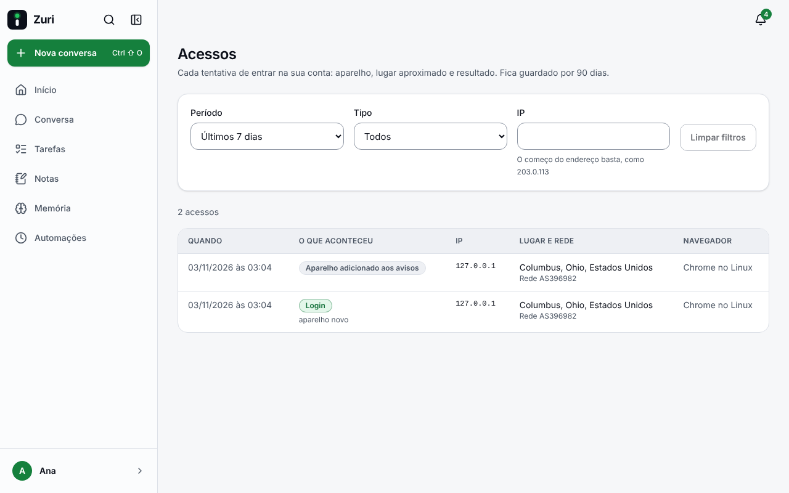
      </picture>
      <p align="center"><b>Acessos</b>: cada tentativa de entrar, com lugar e rede</p>
    </td>
  </tr>
</table>

<details>
<summary><b>No celular</b></summary>
<br>
<p align="center">
  <picture>
    <source media="(prefers-color-scheme: dark)" srcset="docs/capturas/entrar-celular-escuro.png">
    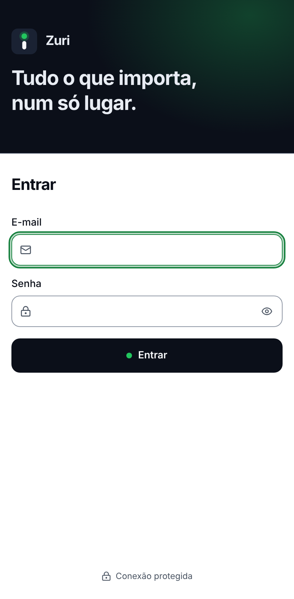
  </picture>
  &nbsp;
  <picture>
    <source media="(prefers-color-scheme: dark)" srcset="docs/capturas/inicio-celular-escuro.png">
    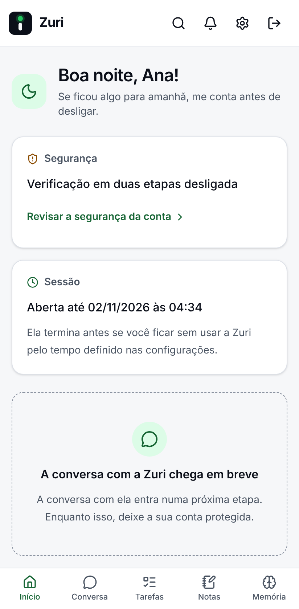
  </picture>
  &nbsp;
  <picture>
    <source media="(prefers-color-scheme: dark)" srcset="docs/capturas/tarefas-celular-escuro.png">
    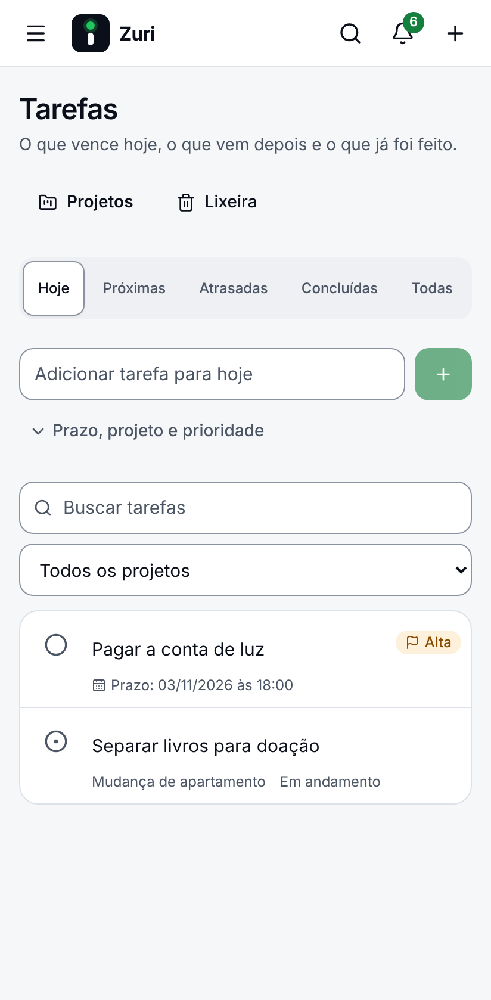
  </picture>
  &nbsp;
  <picture>
    <source media="(prefers-color-scheme: dark)" srcset="docs/capturas/conversa-celular-escuro.png">
    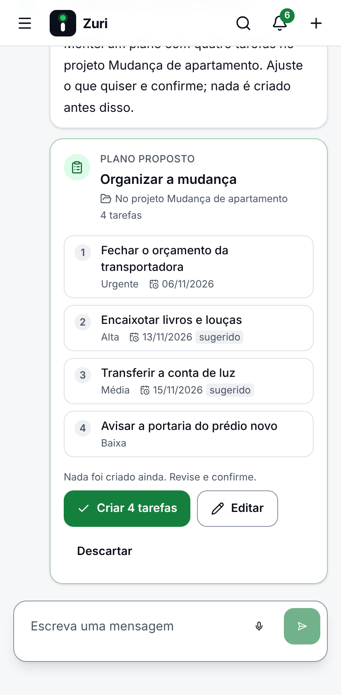
  </picture>
</p>
</details>

## ✅ O que já funciona

O que está na `develop` hoje, etapa por etapa. "extra" marca melhorias feitas fora das etapas.

| | Funcionalidade | O que faz | Etapa |
| :---: | --- | --- | :---: |
| 🛡️ | **Portões de segurança** | Um Worker só, que serve a interface e a API. Toda requisição passa por host permitido, HTTPS, Cloudflare Access opcional, cabeçalhos de segurança e autenticação. | 1 |
| 🌐 | **Idiomas e fuso** | pt-BR por padrão e inglês, datas no padrão brasileiro e fuso `America/Sao_Paulo`. Os erros da API saem no idioma do dono. | 2 |
| 🔑 | **Login e sessões** | Senha forte, sessão que termina por inatividade, proteção contra força bruta e Cloudflare Turnstile em toda tentativa de entrar. | 3 |
| 🗝️ | **Primeiro acesso seguro** | O dono se cadastra uma vez só (e já diz como quer ser chamado), com um código de instalação gravado como segredo (vale 1 hora; erros pausam e bloqueiam só a rede de quem tenta), e liga o 2FA antes de tudo, numa tela de três passos. Um código novo só recupera o acesso, na mesma tela. | extra |
| 📱 | **2FA e passkeys** | Aplicativo autenticador (TOTP), 10 códigos de recuperação e passkeys no segundo passo. Ligar o 2FA e criar uma passkey pedem a senha na hora. Alerta a cada 3 códigos errados seguidos; com 30 erros em 24 h, o segundo passo fica suspenso para redes desconhecidas. | 4 |
| 🧭 | **Interface web (PWA)** | Barra lateral recolhível no jeito dos apps de conversa, com "Nova conversa" em destaque (Ctrl ⇧ O) e o menu da conta no pé (Configurações, Acessos, tema e Sair); no celular ela abre como gaveta. Carregamento com linhas cinzas e uma linha verde no topo, só depois de 300 ms. Tema claro, escuro ou do sistema, instalável no celular e no computador. | 5 |
| 🔄 | **Atualização automática** | O que muda em tarefas, notas, memórias, automações, lixeira e conversas recentes aparece na tela aberta sem recarregar, só no trecho que mudou, com um brilho verde de 2 segundos. Vale para o que você faz, o que a Zuri faz na conversa e o que chega de fora (Telegram, rotinas, outro aparelho), na hora, por uma conexão em tempo real que só exige login válido; se ela cair, chega em até 1 minuto. Contagens no menu (tarefas de hoje) e nas abas de Tarefas. Uma nota aberta nunca perde o que você digitou: a Zuri avisa e você escolhe a versão. | extra |
| 👋 | **Início** | Um campo para escrever para a Zuri, três ideias para começar e os cartões Hoje e Próximos dias. Bom dia, boa tarde ou boa noite pelo seu fuso, com o seu nome (Configurações > Conta) e uma frase curta da Zuri que muda a cada dia. | extra |
| ⌨️ | **Paleta de comandos** | Ctrl/⌘ K (ou o botão Buscar) abre a busca de tarefas, notas e memórias (também pelo significado, com a busca semântica ligada) o caminho para qualquer página ou seção das configurações e "Perguntar à Zuri" quando você digita uma frase, tudo pelo teclado. | extra |
| 👀 | **Acessos** | Cada tentativa de entrar, com IP, cidade, país, rede, navegador e resultado, filtrável por período e tipo. | extra |
| ✅ | **Tarefas e projetos** | Hoje, próximas, atrasadas e concluídas, com prioridade, prazo no seu fuso e projetos. | 6 |
| 📝 | **Notas** | Markdown seguro, busca de texto completo (com ou sem acento) e lixeira de 30 dias. | 6 |
| 🧠 | **Memória** | Fatos que você guarda, edita e apaga. O que muda vira histórico (atual, incerto ou passado), e conflitos vão para uma fila de revisão. | 7 |
| 📊 | **IA com medição** | Workers AI com contador por chamada e um teto único de 9.000 Neurons por dia, com aviso claro ao chegar nele. | 8 |
| 🛟 | **Modelo reserva** | Se o modelo de conversa estiver ocupado ou fora do ar, outro modelo grátis responde no lugar, com a marca "Respondida pelo modelo reserva". Nada sensível (e-mail, senha, sessões, Acessos) chega à IA, conferido por teste. | extra |
| 💬 | **Conversa com ferramentas** | Respostas em tempo real, num tom simpático e natural, chamando você pelo nome. A Zuri cria e organiza tarefas, notas e memórias; o que apaga ou reescreve vira um cartão para você aprovar, e planos de tarefas só viram tarefas depois da sua confirmação. Sabe a data e a hora no seu fuso, entende "amanhã" e "sexta que vem" e responde sempre no idioma das Configurações. Também aceita voz. | 9 |
| ⏰ | **Automações** | Lembretes, o resumo das tarefas e rotinas da Zuri, por dia, semana, mês ou a cada algumas horas, sempre no seu fuso. A rotina que a Zuri sugere na conversa só roda depois que você aprova, e um reinício nunca faz nada rodar duas vezes. | 10 |
| 🔔 | **Central de avisos** | Um sino com contador junta os resultados das automações, o resumo do dia, prazos chegando, tarefas paradas, rotinas falhando, o uso da IA perto do limite e os alertas de segurança. Alerta de segurança não pode ser silenciado e só sai com a senha. | 11 |
| 🩺 | **Diagnóstico** | Em Configurações, as falhas dos últimos 30 dias por tipo (nunca o que você escreveu), com aviso quando uma falha se repete ou aparece numa versão nova, e um botão que abre o relato do problema no GitHub já preenchido. | 11 |
| 📲 | **Notificação no aparelho** | Os avisos chegam ao celular ou ao computador com a Zuri fechada, em até 3 aparelhos, cifrados de ponta a ponta e discretos na tela bloqueada (o conteúdo fica no app). Você escolhe o que vai para cada canal, e um aparelho novo pede a senha e avisa nos outros. | 11 |
| 📧 | **E-mail e "Esqueci minha senha"** | Avisos também por e-mail, com assunto discreto e no máximo 10 por dia (4 guardados para segurança). Na tela de entrada, um link de 30 minutos no seu e-mail cria uma senha nova, pedindo o código do autenticador quando a verificação em duas etapas está ligada. | 11 |
| 🤖 | **Bot do Telegram conectado** | Em Configurações > Avisos, um código de uso único liga a sua conta do Telegram ao bot, e o vínculo só vale depois de você confirmar a conta no app com a senha. O bot só atende essa conta, só no chat privado, ignora mensagens repetidas e sai de grupos; quem não é você não recebe resposta nem deixa nada gravado. | 12 |
| 🔔 | **Avisos no Telegram** | Os avisos chegam no chat com o bot, ou num grupo opcional com um tópico por tipo, discretos por padrão (o texto só com "Texto completo" ligado), sem links clicáveis no meio e com som só nos importantes. Os botões Feito, Adiar 1 h e Silenciar resolvem o aviso ali mesmo, e só a sua conta consegue tocar neles. Alertas de segurança vão sempre ao chat privado. | 13 |
| 💬 | **Conversa e voz no Telegram** | Com a conversa ligada no cartão do Telegram, você escreve ou manda um áudio para o bot e a Zuri responde como no app, com as mesmas memórias e ferramentas; a conversa aparece na sua lista. Áudio de até 5 min e 5 MB é transcrito na hora; acima disso a Zuri pergunta antes, com o custo, e nada é baixado sem o seu toque. Texto encaminhado ou citado vale como dado, nunca como ordem. | 14 |
| 🔐 | **Trava de leitura do bot** | Depois de 12 horas sem usar o bot (você escolhe de 1 a 72), a Zuri para de ler o que chega pelo Telegram até você mandar `/destravar` e confirmar com a passkey, numa página do app, ou com um código de 6 dígitos enviado ao seu e-mail. A leitura fica liberada por 12 horas, e cada destravamento aparece em Acessos. `/nova_conversa` começa outra conversa. | 15a |
| ⚡ | **Comandos rápidos no Telegram** | `/hoje`, `/tarefas`, `/nova`, `/feito`, `/lembrar`, `/nota`, `/buscar`, `/memoria`, `/rotinas`, `/avisos`, `/uso`, `/status` e `/backup` respondem na hora, sem gastar IA. `/nova pagar a luz amanhã 9h` entende a data, com o botão Corrigir; a lista de tarefas tem Feito e Adiar, e concluir tem Desfazer por 5 minutos. Foto ou documento com legenda vira nota, sem guardar o arquivo. | 15b |
| ✋ | **Aprovar pelo Telegram** | Quando a Zuri propõe apagar ou reescrever algo numa conversa pelo bot, a proposta chega com o botão Aprovar e uma prévia montada com o que está guardado, nunca com as palavras dela. Tocar não basta: você confirma com a passkey, numa página do app, ou com um código no seu e-mail, e só então a proposta é feita, uma vez. `/aprovar` mostra o que espera por você, e cada aprovação aparece em Acessos. | 16a |
| 🚨 | **Emergência pelo Telegram** | `/acessos` e `/sessoes` mostram quem entrou e o que está aberto; `/encerrar_sessoes`, `/pausar_rotinas` e `/bloquear` agem com um toque, mesmo com a IA fora do ar. O modo de bloqueio derruba as sessões do app, para as rotinas com IA e deixa o bot só com `/status`, `/avisos` e `/ajuda`. Na primeira hora só se entra com um código de recuperação; depois, o app abre em Sair do bloqueio, com **Não fui eu: desvincular o Telegram**. Os alertas que o bot causa só param quando você confirma no app, com a senha. | 16b |
| 🔎 | **Busca pelo significado** | Opcional, em Configurações > IA. Ligada, a busca acha "carro" na memória sobre o "automóvel": a paleta ganha o grupo "Pelo significado", a Zuri lembra das memórias certas na conversa e `/buscar` também acha rotinas. Tudo fica no banco da sua Zuri, com o modelo grátis do Workers AI e no máximo 2.000 textos por dia, sem passar de metade do teto de IA. Desligada, nada muda. | 17 |
| 🔌 | **Serviços externos (MCP)** | Em Configurações > Integrações, você adiciona servidores MCP (sem login, com um token guardado cifrado ou entrando com a conta do serviço por OAuth) e liga, uma por uma, as ferramentas que a Zuri pode usar. Cada chamada vira um cartão com os dados exatos que vão para o serviço, e o cartão também se aprova pelo bot do Telegram. Você escolhe, ferramenta por ferramenta, se ela roda sem perguntar na conversa ou também nas rotinas, e pode liberar uma ferramenta só para uma rotina; as que o serviço marca como destrutivas sempre perguntam. Com a busca pelo significado ligada, a Zuri acha a ferramenta certa mesmo sem palavra em comum. Só endereços públicos, nunca redirecionamento, e nada externo no modo de bloqueio. | 18 |
| 📅 | **Google Agenda** | Em Configurações > Integrações, você conecta a sua conta do Google pelo seu próprio app OAuth, de graça, e escolhe agenda por agenda: fechada (padrão), só ler, ou ler e editar. A tela **Agenda** mostra os eventos por dia, semana ou mês, cria, edita e apaga eventos nas agendas abertas para edição e acompanha o Google na hora: o que muda lá aparece aqui sem recarregar. Na conversa, a Zuri consulta, cria e muda eventos; apagar, ou mudar evento com convidados, vira cartão para aprovar. `/hoje` no Telegram mostra a agenda do dia, e Automações ganha os modelos Briefing da manhã e Fechamento do dia. Ninguém é convidado nem avisado pela Zuri, e os tokens ficam cifrados. | 19 |
| 👥 | **Google Contatos** | No cartão Google Agenda e Contatos, você liga os contatos com a mesma conta e escolhe quais etiquetas a Zuri copia, só para leitura, até 5.000 contatos, atualizados de hora em hora. A tela **Contatos** busca por nome, pedaço do telefone ou e-mail e mostra os detalhes de cada um. A Zuri avisa dos aniversários do dia e, se você quiser, das datas especiais, e na conversa e nas rotinas consulta os contatos. Ela nunca muda nada no Google nem manda mensagem a ninguém, e os contatos ficam fora do log. | 19b |
| 🔁 | **Fluxos e monitor de sites** | Em Automações, a aba **Fluxos** monta passos que rodam sozinhos: chamar um serviço seu, filtrar, montar campos, esperar, avisar você e pedir um resumo à IA. O modelo **Monitorar sites** olha até 10 endereços a cada 15 minutos, testa de novo antes de dizer que um site caiu e avisa na queda e na volta. Um fluxo só chama as conexões que você cadastrou, com os caminhos e métodos marcados (nunca DELETE) e a credencial cifrada, que não volta para a tela. Todo fluxo nasce desligado, ligar pede a senha e só a tela mexe neles. `/status` no bot mostra os sites. | 22a |
| ⭐ | **Avaliações do Google** | Em Contatos, a aba **Avaliações** mostra as avaliações do seu Perfil da Empresa no Google, lidas a cada 15 minutos. As de 1 a 3 estrelas avisam a equipe no tópico "Avaliações" do Telegram e ganham um rascunho cuidadoso; as de 4 e 5 estrelas ganham rascunho de um modelo seu ou de um agente próprio, sem ferramentas. Toda resposta passa por uma conferência fixa e a Zuri relê a avaliação no Google antes de publicar. Depois de 10 rascunhos aprovados por você sem mudança, dá para liberar a Zuri a publicar sozinha as positivas (com senha e alerta de segurança), até 3 por leitura e 10 por dia, com a aba **Publicadas sozinha** para apagar qualquer resposta; três rascunhos reprovados seguidos, uma recusa do Google ou uma resposta apagada fazem ela voltar a pedir aprovação. Nome e texto das avaliações ficam fora do log. | 19c, 19d |
| 🤝 | **CRM interno e eventos do n8n** | Em Contatos, a aba **Clientes** guarda até 5.000 clientes com etapa do funil (que você edita), etiquetas, anotações, retorno e aniversário, e um histórico de cada um. A Zuri avisa dos retornos na hora, dos aniversários às 9 h e dos clientes novos que chegam do n8n. O n8n manda clientes, mensagens e agendamentos por eventos assinados com um segredo que aparece uma vez, até 300 por hora e 1.000 por dia. Na conversa, a Zuri busca, cadastra e muda etapa, etiquetas e retorno sem perguntar, mas só a tela apaga cliente; telefone e e-mail só aparecem quando você pede, e nada dos clientes vai para o log. Pedir um fluxo na conversa deixa uma sugestão na aba Fluxos, que só vira fluxo, desligado, quando você salva. | 22b |
| 📅 | **Agenda e contatos nos fluxos** | Os fluxos ganham três passos: **Ler a agenda** (os eventos de uma agenda aberta à Zuri, de tantos dias a partir de hoje), **Criar evento** (um por item, até 10 por execução, sem convidados e sem e-mail a ninguém, com uma chave que impede repetir o mesmo evento) e **Buscar contatos** (na cópia dos seus contatos do Google, por nome, telefone, etiqueta ou aniversário, sem chamar o Google). Nenhum passo muda ou apaga evento. | 22c |
| 🔑 | **Acesso remoto e eventos** | Em Configurações › Segurança, **Acesso remoto** cria tokens para o n8n, o Home Assistant ou um script falarem com a Zuri de outro servidor: **Só ler**, **Ler e escrever** (tarefas, notas, memórias e lembretes) ou **Só eventos**, que manda avisos como "n8n: Backup falhou" para a central. O token aparece uma vez, vale 90 dias e só alcança uma lista fechada de rotas; nunca chega a login, Telegram, aprovações, fluxos, CRM nem a rotinas com IA. Ligar e criar pedem a senha e geram alerta de segurança; `/tokens` no bot revoga com um toque, e o modo de bloqueio suspende todos. Eventos: até 60 por hora e 100 por dia, usando no máximo metade do limite de cada canal. | 20 |
| 🎯 | **Prioridade que aprende** | O tipo de aviso que você quase sempre deixa de lado desce um nível, e o que você abre logo sobe, no máximo um nível por semana e sempre com "Desfazer". Lembretes e segurança nunca mudam, e cada automação tem a sua prioridade. | 11 |

## 🔭 O que vem a seguir

| | Funcionalidade | O que faz | Etapa |
| :---: | --- | --- | :---: |
| 💾 | **Backup e instalação** | Backup e importação, guia de instalação só pelo navegador e auditoria final. | 23–25 |

## 🧭 Como funciona

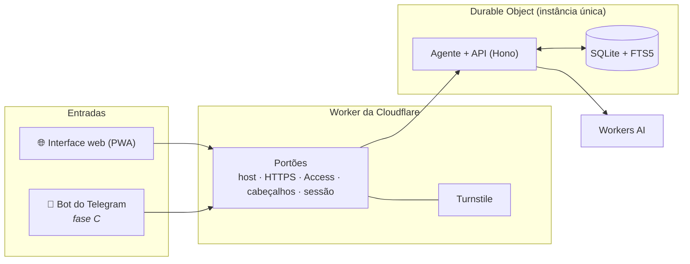

O bot não terá caminho próprio: ele vai passar pelos mesmos portões da interface e chegar ao mesmo agente, aos mesmos dados e aos mesmos limites.

| Camada | Tecnologia |
| --- | --- |
| Worker e API | [Hono](https://hono.dev) sobre Cloudflare Workers |
| Agente e dados | [Agents SDK](https://developers.cloudflare.com/agents/), Durable Object com SQLite e FTS5, migrations só de acréscimo |
| IA | Workers AI; modelos pagos desligados e só com aprovação ⚠️ |
| Interface | React, Vite, Tailwind, TanStack Query e React Router, servida pelo próprio Worker |
| Validação | Zod no servidor e Zod Mini na interface, com os schemas em `packages/shared` |
| Testes | Vitest dentro do workerd, Playwright, axe e Lighthouse |

Mais detalhes em [docs/arquitetura.md](docs/arquitetura.md).

## 🔒 Segurança e privacidade

- **Dono único.** Não há cadastro nem contas de outras pessoas.
- **Login forte.** Senha de 15 caracteres ou mais, Turnstile validado no Worker antes da senha, 2FA, passkeys, códigos de recuperação e defesa contra ataque lento ao segundo passo.
- **Você vê quem tentou.** A página Acessos registra cada tentativa. O IP fica no banco da Zuri e não vai para os logs.
- **Agente com limites.** Sem shell, execução de código, HTTP livre, credenciais ou deploy. Ação destrutiva vira proposta e só roda com a sua aprovação.
- **Conteúdo é dado, nunca instrução.** Notas, memórias, mensagens e resultados de ferramentas entram no modelo em blocos `<data>` neutralizados. Os cenários de injeção de prompt são testados com um modelo que obedece ao texto injetado, e mesmo assim nada é apagado sem você.
- **Segredos só no Worker.** Nada sensível no navegador, no repositório ou nos logs. A CSP da interface é testada na CI.
- **Sem telemetria.** Nenhuma chamada a serviços dos desenvolvedores.

Detalhes em [docs/seguranca.md](docs/seguranca.md). Para relatar uma vulnerabilidade, siga o [SECURITY.md](SECURITY.md) e não abra issue pública.

## 💸 Plano Free, sem surpresa na fatura

| Recurso | Plano Free | Como a Zuri usa |
| --- | :---: | --- |
| Workers, Durable Objects com SQLite | ✅ | Tudo roda aqui, com orçamento por rota medido nos testes |
| Workers AI | ✅ | Teto único de 9.000 Neurons por dia (a cota é 10.000), zerado às 00:00 UTC |
| Turnstile, Email Routing, Cloudflare Access | ✅ | Turnstile no login; os outros são opcionais |
| Modelos pagos (Anthropic, OpenAI) | ⚠️ | Desligados. Só com a sua aprovação e um teto diário em US$ |
| KV, D1, R2, Vectorize, Queues, Workers Paid | ⚠️ | Não usados. Qualquer recurso que gere cobrança exige aprovação explícita |

O orçamento de cada cota está em [docs/arquitetura/orcamento-free-tier.md](docs/arquitetura/orcamento-free-tier.md). AI Gateway, Hyperdrive e Vectorize foram avaliados e ficaram de fora; os motivos estão em [docs/planos/ai-gateway-hyperdrive-vectorize.md](docs/planos/ai-gateway-hyperdrive-vectorize.md). A troca automática de provedor de IA e a proteção do que vai para os modelos estão planejadas em [docs/planos/troca-de-provedores-e-protecao-de-dados.md](docs/planos/troca-de-provedores-e-protecao-de-dados.md). O caminho para rodar o Zuri numa VPS, caso a Cloudflare deixe de servir, está em [docs/planos/portabilidade-vps.md](docs/planos/portabilidade-vps.md). A viabilidade de trazer os fluxos de CRM do n8n para a etapa 22 está em [docs/planos/workflows-n8n.md](docs/planos/workflows-n8n.md).

## 🗺️ Mapa das etapas

✅ mesclada · 🚧 em andamento · ⬜ a fazer

<!-- inicio:etapas: a coluna Situação, o selo e as contagens vêm de scripts/readme.ts (workflow README); mude só as outras colunas -->
| Fase | Etapa | Entrega | Situação |
| --- | :---: | --- | :---: |
| **A · Fundação** | 0 | Repositório, CI, CodeQL e rulesets | ✅ |
| | 1 | Worker, Durable Object e portões | ✅ |
| | 2 | Banco, configurações e i18n | ✅ |
| | 3 | Login e sessões | ✅ |
| | 4 | 2FA e passkeys | ✅ |
| | 5 | Casca da interface e identidade visual | ✅ |
| **B · Assistente na web** | 6 | Tarefas, notas e projetos | ✅ |
| | 7 | Memória e histórico | ✅ |
| | 8 | Provedor de IA e medição de uso | ✅ |
| | 9 | Chat com ferramentas | ✅ |
| | 10 | Automações | ✅ |
| | 11 | Central de avisos, push e e-mail | ✅ |
| **C · Bot do Telegram** | 12 | Fundação do bot | ✅ |
| | 13 | Avisos no Telegram | ✅ |
| | 14 | Conversa e voz | ✅ |
| | 15a | Trava de leitura e `/destravar` | ✅ |
| | 15b | Comandos administrativos | ✅ |
| | 16a | Aprovações pelo bot | ✅ |
| | 16b | Comandos de segurança e modo de bloqueio | ✅ |
| **D · Integrações** | 17 | Busca semântica | ✅ |
| | 18a | Servidores MCP remotos | ✅ |
| | 18b | Login OAuth nos servidores MCP | ✅ |
| | 19 | Google Agenda | ✅ |
| | 19b | Google Contatos | ✅ |
| | 19c | Avaliações do Google com aprovação | ✅ |
| | 19d | Resposta automática das avaliações | ✅ |
| | 20 | Acesso remoto e eventos | ✅ |
| | 21 | Modelos pagos ⚠️ | ⬜ |
| | 22a | Motor de fluxos e monitor de sites | ✅ |
| | 22b | CRM interno e eventos do n8n | ✅ |
| | 22c | Passos da agenda e dos contatos | ✅ |
| **E · Fechamento** | 23 | Backup, importação e retenção | ⬜ |
| | 24 | Deploy e guia de instalação | ⬜ |
| | 26 | Revisão de textos e experiência (antes da 25) | ⬜ |
| | 25 | Auditoria final e testes de ponta a ponta | ⬜ |
<!-- fim:etapas -->

Além das etapas, PRs de melhoria já trouxeram o Turnstile em todo login, a página Acessos, o menu recolhível, a revisão de design e o orçamento de performance. Tudo isso está no [CHANGELOG](CHANGELOG.md).

## 🚀 Rodar localmente

Requer Node.js 24 ou mais novo (a versão fixada está em [`.nvmrc`](.nvmrc)).

```bash
npm ci
npm run dev        # Worker local com IA simulada e a interface
```

Antes do primeiro `npm run dev`, crie o `apps/agent/.dev.vars` com valores locais, como explica [docs/arquitetura.md](docs/arquitetura.md#desenvolvimento-local).

| Comando | Para quê |
| --- | --- |
| `npm run typecheck` | TypeScript em todos os pacotes |
| `npm run lint` | Biome e o lint de textos sem tradução |
| `npm test` | Testes unitários e de integração, dentro do workerd |
| `npm run i18n` | Confere o catálogo em pt-BR e en |
| `npm run test:e2e` | Testes de interface com Playwright |
| `npm run build` | Build da interface e do Worker |

A instalação na sua conta Cloudflare será feita só pelo navegador (fork, segredos e GitHub Actions); o deploy automático chega na etapa 24. Os segredos, a verificação contra robôs, o primeiro acesso com o código de instalação e a recuperação do acesso já estão em [docs/configuracao-cloudflare.md](docs/configuracao-cloudflare.md).

## 🧪 Qualidade

Antes de entrar na `develop`, cada etapa passa por:

1. **Testes primeiro.** Todo critério de aceite tem um teste automatizado, ligado a ele numa matriz no PR.
2. **Camadas.** Unitário, integração no workerd, contrato da API, e2e, acessibilidade (axe), i18n e casos de abuso.
3. **Pisos na CI.** Cobertura mínima (99% no agente), Lighthouse 95 ou mais, teste de CSP e um teto para o JS inicial da interface que só pode descer.
4. **QA e auditoria.** Revisão de QA independente e auditoria de segurança em toda etapa, com correção e teste para cada achado.

Estratégia completa em [docs/qa/estrategia-de-testes.md](docs/qa/estrategia-de-testes.md).

## 📁 Estrutura do repositório

```text
apps/
  agent/        Worker, Durable Object, API (e, na fase C, o bot do Telegram)
  web/          Interface React (PWA)
packages/
  shared/       Schemas Zod, constantes, criptografia e catálogo de textos (pt-BR e en)
docs/           Documentação em pt-BR: especificação, arquitetura, QA e capturas
tests/e2e/      Testes de interface com Playwright
scripts/        Lint de i18n, ícones, tamanho do pacote e capturas do README
.claude/        Regras, skills, subagentes e memória do agente de desenvolvimento
```

## 📚 Documentação

| Documento | Assunto |
| --- | --- |
| [Especificação](docs/especificacao.md) | Escopo, contratos e as 28 etapas |
| [Arquitetura](docs/arquitetura.md) | Worker, Durable Object, portões e desenvolvimento local |
| [Segurança](docs/seguranca.md) | Login, sessões, 2FA, passkeys e o modelo de ameaças |
| [Interface](docs/interface.md) | Telas, acessibilidade e a identidade visual Sinal |
| [Produtividade](docs/produtividade.md) | Tarefas, notas, projetos e lixeira |
| [Memória](docs/memoria.md) | Estados, histórico e revisão de conflitos |
| [Busca por significado](docs/semantic-recall.md) | Busca semântica opcional, limites e custo |
| [Serviços externos (MCP)](docs/mcp.md) | Servidores MCP, login OAuth, aprovação das chamadas (no app e no bot), limites e proteções |
| [Google Agenda](docs/google-agenda.md) | Conectar a conta, o que cada agenda permite, a tela Agenda em tempo real e como criar o cliente OAuth do Google |
| [Google Contatos](docs/google-contatos.md) | Ligar os contatos, escolher as etiquetas, a tela Contatos, os avisos de aniversário e o que muda no cliente OAuth |
| [Avaliações do Google](docs/avaliacoes-google.md) | Ligar as avaliações, o que a Zuri faz com cada uma, a conferência das respostas, o que ligar no Google Cloud, limites e custo |
| [Fluxos e monitor de sites](docs/fluxos.md) | A aba Fluxos, os passos (inclusive agenda e contatos), as conexões e suas travas, o monitor de sites, limites e custo |
| [CRM interno e eventos do n8n](docs/crm.md) | A aba Clientes, o funil, os avisos, o que a conversa pode fazer, como o n8n assina e manda eventos, respostas e limites |
| [Acesso remoto e eventos](docs/acesso-remoto.md) | Tokens por escopo, o que cada um alcança, eventos para a central, exemplos com `curl` e o n8n, limites e o Cloudflare Access |
| [Avisos e Diagnóstico](docs/avisos.md) | Central de avisos, insistência, resumo do dia, vigias e registro de falhas |
| [Configurar a Cloudflare](docs/configuracao-cloudflare.md) | Segredos, Turnstile, primeiro acesso e recuperação |
| [Configurar o GitHub](docs/configuracao-github.md) | Rulesets e proteção das branches |

## 🤝 Como contribuir

Leia o [CONTRIBUTING.md](CONTRIBUTING.md) e o [AGENTS.md](AGENTS.md). Em resumo:

- Branch a partir da `develop` e PR sempre para a `develop`. A `main` só recebe releases.
- Título em Conventional Commits, com o texto em pt-BR (`feat(telegram): adiciona o comando /hoje`).
- Testes junto com o código, changelog num arquivo em `changelog/nao-lancado/`, este README atualizado e o modelo de PR preenchido.
- Cada merge na `develop` vira uma versão 0.x com tag e pré-release no GitHub; a versão em uso aparece no pé do menu lateral (no celular, no pé da lista de Configurações) e em Configurações > Diagnóstico, e é a mesma em todos os `package.json` e no `package-lock.json` ([como funciona](docs/agente/versionamento.md)).
- Todo texto visível em pt-BR e en, pelo catálogo de i18n.

## 🌎 In English

**Zuri** is a self-hosted, single-owner AI assistant that runs entirely in your own Cloudflare account: one Worker, one Durable Object with SQLite and Workers AI, designed to fit the Free plan. It has a web app (PWA) and a Telegram admin bot that sends notifications, chats, answers quick commands and approves the agent's proposals with a passkey or an e-mailed code. Sign-in uses Turnstile, TOTP 2FA and passkeys, and the agent has no shell, code execution or open HTTP.
It's built in public in 35 steps; steps 0 to 20 are merged.
The docs and the UI default to Brazilian Portuguese, and the interface is also available in English.

## 🙌 Créditos e licença

A Zuri é inspirada no [Talorys](https://github.com/pablopfg/talorys), assistente pessoal de IA na Cloudflare, e acrescenta o bot de administração no Telegram. Trechos reaproveitados mantêm o aviso de copyright em [NOTICE.md](NOTICE.md).

Licença [MIT](LICENSE).

<div align="center">
<br>

<br>
<sub>A luz verde quer dizer que a Zuri está trabalhando.</sub>
</div>
