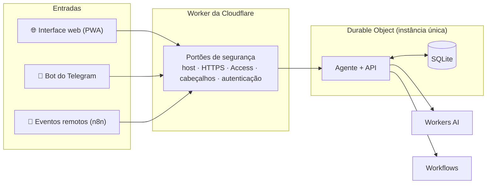

<div align="center">


# Zuri

**Seu assistente pessoal de IA, na sua conta Cloudflare, no navegador e no Telegram.**

Gratuito e de código aberto. Um único dono, nenhum servidor de terceiros:<br>
as conversas, as memórias e as tarefas ficam na sua conta.

[](LICENSE)
[](https://developers.cloudflare.com/workers/)
[](#-o-bot-do-telegram)
[](#-o-que-é-gratuito-e-o-que-pode-custar)
[](#-segurança-e-privacidade)
[](.nvmrc)

[Instalação](#-instalação) · [Documentação](docs/) · [Segurança](SECURITY.md) · [Como contribuir](CONTRIBUTING.md) · [Changelog](CHANGELOG.md)

</div>

> [!IMPORTANT]
> **O Zuri está em construção.** Ele é desenvolvido em 26 etapas, uma por PR, a partir da [especificação](docs/especificacao.md). O andamento fica em [`.claude/memoria/progresso.md`](.claude/memoria/progresso.md). As funções abaixo descrevem o produto completo; cada uma vale a partir da etapa que a entrega.

---

## Sumário

- [Por que Zuri](#por-que-zuri)
- [✨ Funcionalidades](#-funcionalidades)
- [🤖 O bot do Telegram](#-o-bot-do-telegram)
- [🧭 Como funciona](#-como-funciona)
- [🔒 Segurança e privacidade](#-segurança-e-privacidade)
- [💸 O que é gratuito e o que pode custar](#-o-que-é-gratuito-e-o-que-pode-custar)
- [🚀 Instalação](#-instalação)
- [🛠️ Desenvolvimento](#️-desenvolvimento)
- [🧪 Qualidade e testes](#-qualidade-e-testes)
- [🗺️ Roteiro](#️-roteiro)
- [📁 Estrutura do repositório](#-estrutura-do-repositório)
- [🤝 Como contribuir](#-como-contribuir)
- [🙌 Origem e créditos](#-origem-e-créditos)
- [📄 Licença](#-licença)

---

## Por que Zuri

O Zuri junta conversa, memória, tarefas, notas, lembretes e avisos num lugar só, e trabalha sozinho enquanto você faz outra coisa. Você fala com ele por dois caminhos que valem o mesmo:

- **No navegador**, pela interface web instalável (PWA) no celular e no computador.
- **No Telegram**, por um bot que é só seu: consulta rápida, conversa por texto e voz, aprovações com passkey e um botão de emergência.

Tudo roda num único Worker da Cloudflare, com os dados no SQLite de um Durable Object da sua conta. Sem banco externo, sem servidor para manter e sem cobrança no plano gratuito.

## ✨ Funcionalidades

### Assistente

| | Funcionalidade | O que faz |
| :---: | --- | --- |
| 💬 | **Chat** | Respostas em tempo real, Markdown, atividade das ferramentas à vista e botão para parar. Conversas longas ganham resumo automático. |
| 🎙️ | **Voz** | Fale até 1 minuto no app (ou 5 no Telegram). A transcrição roda no Workers AI da sua conta e o áudio nunca é guardado. |
| 🧠 | **Memória** | Fatos e preferências que você vê, edita e apaga. Só os relevantes vão ao modelo. |
| 🕰️ | **Histórico da memória** | Fatos que mudam com o tempo ficam como atual, incerto ou passado, com revisão de conflitos. |
| 🔎 | **Busca semântica** <sub>opcional</sub> | Encontra pelo significado, além das palavras, em memórias, tarefas, notas e automações. |

### Produtividade

| | Funcionalidade | O que faz |
| :---: | --- | --- |
| ✅ | **Tarefas, notas e projetos** | Pela interface ou pelo chat, com busca, lixeira e validação de datas. |
| 🗺️ | **Planejamento com IA** | Descreva um objetivo e revise o plano num cartão. Nada é criado antes de você confirmar. |
| ⏰ | **Automações** | Lembretes, resumos diários e rotinas de IA, que rodam com os alarmes da Cloudflare. Rotina criada pelo chat espera a sua aprovação. |
| 📣 | **Central de avisos** | Prioridade, categorias, limites por canal, insistência até você tratar e um resumo às 07:30. Alertas de segurança chegam sempre, por todos os canais. |
| 🔔 | **Canais** | Notificação push, e-mail pelo Email Routing e Telegram. |
| 🔁 | **Monitor de sites** | Cloudflare Workflows avisa quando um site cai e quando volta. |

### Integrações

| | Funcionalidade | O que faz |
| :---: | --- | --- |
| 📅 | **Google Agenda** <sub>opcional</sub> | Leitura e escrita de eventos, com briefing do dia às 07:00 e fechamento às 19:00. |
| 🔌 | **Servidores MCP** <sub>opcional</sub> | Ferramentas de servidores MCP remotos, desligadas por padrão. O que altera algo pede aprovação. |
| 🔗 | **Acesso remoto** <sub>opcional</sub> | Tokens com escopo para o n8n e outros serviços enviarem eventos ao Zuri. |
| 🛟 | **Funciona sem IA** | Tarefas, notas, lembretes e os comandos do bot continuam funcionando se a cota de IA acabar. |

## 🤖 O bot do Telegram

O bot é um painel de administração no bolso. Ele só ouve a sua conta, vinculada por um código de uso único e conferida pelo id do Telegram.

| Para quê | Comandos |
| --- | --- |
| Consultar o dia | `/hoje` · `/tarefas` · `/rotinas` · `/avisos` · `/uso` · `/status` |
| Agir rápido | `/nova` · `/feito` · `/lembrar` · `/nota` · `/buscar` · `/memoria` · `/nova_conversa` |
| Segurança | `/acessos` · `/sessoes` · `/encerrar_sessoes` · `/tokens` · `/pausar_rotinas` · `/bloquear` |
| Ajuda | `/ajuda` |

- **Comandos sem IA.** Respondem na hora e não gastam a cota de IA.
- **Conversa.** Texto e voz no chat privado viram uma conversa do app, com o mesmo histórico.
- **Aprovações fortes.** Ações sensíveis se confirmam por **passkey** (digital ou rosto) ou por **código de 6 dígitos no e-mail**. Tocar no botão não basta, e algumas ações nunca saem do app.
- **Trava de leitura.** Depois de 12 h sem uso, o bot só lê até você confirmar que é você.
- **Modo de bloqueio.** `/bloquear` encerra sessões, suspende tokens e trava o acesso em segundos, mesmo com a IA fora do ar.

## 🧭 Como funciona



O bot não tem caminho próprio: passa pelos mesmos portões da interface e chega ao mesmo agente, aos mesmos dados e aos mesmos limites.

| Camada | Tecnologia |
| --- | --- |
| Worker e API | Hono sobre Cloudflare Workers |
| Agente e dados | Agents SDK, Durable Object com SQLite e FTS5 |
| IA | Workers AI (chat, Whisper, embeddings); modelos pagos só com aprovação |
| Interface | React, Vite, Tailwind, TanStack Query, PWA |
| Validação | Zod nos dois lados, schemas compartilhados |
| Testes | Vitest dentro do workerd e Playwright |

## 🔒 Segurança e privacidade

- **Dono único.** Sem cadastro e sem contas de terceiros.
- **Acesso forte.** Senha de 15+ caracteres conferida no HIBP, 2FA, passkeys, códigos de recuperação, Turnstile adaptativo e sessão que expira por inatividade.
- **Agente com limites.** Sem shell, execução de código, HTTP livre ou deploy. Ações destrutivas viram proposta, que só roda com a sua aprovação.
- **Conteúdo é dado, nunca instrução.** Notas, memórias, mensagens do Telegram e resultados de MCP entram no modelo isolados, contra injeção de prompt.
- **Segredos só no Worker.** Nada sensível no navegador, no repositório ou nos logs.
- **Sem telemetria.** Nenhuma chamada a serviços dos desenvolvedores.

Detalhes em [docs/seguranca.md](docs/seguranca.md). Para relatar uma vulnerabilidade, veja [SECURITY.md](SECURITY.md).

## 💸 O que é gratuito e o que pode custar

| Recurso | Plano Free | Observação |
| --- | :---: | --- |
| Workers, Durable Objects com SQLite, Workflows | ✅ | Dentro dos limites diários do plano |
| Workers AI | ✅ | Cota diária de Neurons, com contador e teto no Zuri |
| Email Routing, Turnstile, Cloudflare Access | ✅ | Opcionais |
| Modelos pagos (Anthropic, OpenAI) | ⚠️ | Desligados. Só com a sua aprovação e um teto diário em US$ |
| KV, D1, R2, Vectorize, Queues | ⚠️ | Não usados. Qualquer recurso que gere cobrança exige aprovação explícita |

## 🚀 Instalação

A instalação é feita pelo navegador, sem terminal: você cria um fork, configura os segredos no painel da Cloudflare e no GitHub, e o GitHub Actions publica o Zuri na sua conta.

O passo a passo completo, com o bot do @BotFather, o domínio e o Email Routing, fica em [docs/instalacao-cloudflare.md](docs/instalacao-cloudflare.md), entregue na etapa 24.

## 🛠️ Desenvolvimento

Requer Node.js 24+ (a versão fixada está em [`.nvmrc`](.nvmrc)).

```bash
npm ci
npm run dev        # agente + interface com IA simulada
```

Antes do primeiro `npm run dev`, crie o `apps/agent/.dev.vars` com valores locais, como explica [docs/arquitetura.md](docs/arquitetura.md#desenvolvimento-local).

| Comando | Para quê |
| --- | --- |
| `npm run typecheck` | TypeScript em todos os pacotes |
| `npm run lint` | Biome e o lint de textos sem tradução |
| `npm test` | Testes unitários e de integração (dentro do workerd) |
| `npm run i18n` | Confere o catálogo de traduções em pt-BR e en |
| `npm run test:e2e` | Testes de interface com Playwright |
| `npm run build` | Build da interface e do Worker |

Guia completo em [CONTRIBUTING.md](CONTRIBUTING.md).

## 🧪 Qualidade e testes

Toda etapa passa pelo mesmo crivo antes de entrar na `develop`:

1. **Testes primeiro.** Cada critério de aceite tem um teste automatizado, ligado a ele numa matriz de rastreabilidade no PR.
2. **Camadas.** Testes unitários, de integração no workerd, de contrato da API, e2e, acessibilidade (axe), i18n e casos de abuso.
3. **QA sênior.** Revisão independente de casos de borda, regressão e aderência à especificação.
4. **Auditoria de segurança.** Ela roda em toda etapa e é completa nas etapas sensíveis, com correção e teste para cada achado.
5. **CI obrigatória.** Typecheck, lint, testes, e2e, i18n, build e `npm audit` precisam passar para mesclar.

Estratégia completa em [docs/qa/estrategia-de-testes.md](docs/qa/estrategia-de-testes.md).

## 🗺️ Roteiro

| Fase | Etapas | Entrega |
| --- | --- | --- |
| A · Fundação | 0–5 | Repositório, Worker e portões, banco e i18n, login, 2FA e passkeys, interface |
| B · Assistente na web | 6–11 | Tarefas e notas, memória, IA com medição, chat com ferramentas, automações, avisos |
| C · Bot do Telegram | 12–16 | Vínculo, avisos, conversa e voz, comandos, aprovações e modo de bloqueio |
| D · Integrações | 17–22 | Busca semântica, MCP, Google Agenda, acesso remoto, modelos pagos ⚠️, monitor de sites |
| E · Fechamento | 23–25 | Backup, deploy e guia de instalação, auditoria final |

## 📁 Estrutura do repositório

```text
apps/
  agent/        Worker, Durable Object, API e bot do Telegram
  web/          Interface React (PWA)
packages/
  shared/       Schemas Zod, constantes e catálogo de textos (pt-BR e en)
docs/           Documentação em pt-BR, especificação, QA e ADRs
tests/e2e/      Testes de interface com Playwright
.claude/        Regras, skills, subagentes e memória do agente de desenvolvimento
```

## 🤝 Como contribuir

Leia o [CONTRIBUTING.md](CONTRIBUTING.md) e o [AGENTS.md](AGENTS.md). Em resumo:

- Branch a partir da `develop` e PR sempre para a `develop`.
- Título em Conventional Commits, com o texto em pt-BR (`feat(telegram): adiciona o comando /hoje`).
- Testes junto com o código, changelog atualizado e o modelo de PR preenchido.
- Todo texto visível em pt-BR e en.

## 🙌 Origem e créditos

O Zuri é inspirado no [Talorys](https://github.com/pablopfg/talorys), assistente pessoal de IA na Cloudflare, e acrescenta o bot de administração no Telegram. Trechos reaproveitados mantêm o aviso de copyright em [NOTICE.md](NOTICE.md).

## 📄 Licença

[MIT](LICENSE).
