<div align="center">

<picture>
  <source media="(prefers-color-scheme: dark)" srcset="docs/assets/zuri-banner-escuro.svg">
  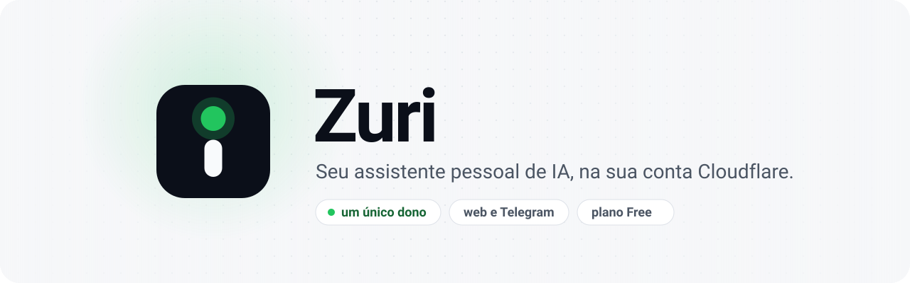
</picture>

<br>

[](https://github.com/pablopfg/Zuri/actions/workflows/ci.yml?query=branch%3Adevelop)
[](https://github.com/pablopfg/Zuri/actions/workflows/codeql.yml?query=branch%3Adevelop)
[](LICENSE)
[](https://developers.cloudflare.com/workers/)
[](#-plano-free-sem-surpresa-na-fatura)
[](#️-mapa-das-etapas)
[](#-segurança-e-privacidade)
[](.nvmrc)

**Um assistente de IA que é só seu.** Ele roda num único Worker da sua conta Cloudflare, guarda tudo no SQLite<br>
de um Durable Object e conversa com você pelo navegador e, em breve, pelo Telegram.

[Telas](#-telas) · [O que já funciona](#-o-que-já-funciona) · [Como funciona](#-como-funciona) · [Mapa das etapas](#️-mapa-das-etapas) · [Rodar localmente](#-rodar-localmente) · [Contribuir](CONTRIBUTING.md)

</div>

> [!NOTE]
> **Em construção.** A Zuri sai em 26 etapas, uma por PR, a partir da [especificação](docs/especificacao.md). As etapas 0 a 9 estão na `develop`, inclusive a conversa com o agente. O [mapa das etapas](#️-mapa-das-etapas) mostra o que já existe e o que vem a seguir; o estado detalhado fica em [`progresso.md`](.claude/memoria/progresso.md).

## Sumário

- [Por que o Zuri](#-por-que-o-zuri)
- [Telas](#-telas)
- [O que já funciona](#-o-que-já-funciona)
- [O que vem a seguir](#-o-que-vem-a-seguir)
- [Como funciona](#-como-funciona)
- [Segurança e privacidade](#-segurança-e-privacidade)
- [Plano Free, sem surpresa na fatura](#-plano-free-sem-surpresa-na-fatura)
- [Mapa das etapas](#️-mapa-das-etapas)
- [Rodar localmente](#-rodar-localmente)
- [Qualidade](#-qualidade)
- [Estrutura do repositório](#-estrutura-do-repositório)
- [Documentação](#-documentação)
- [Como contribuir](#-como-contribuir)
- [In English](#-in-english)
- [Créditos e licença](#-créditos-e-licença)

## 💡 Por que o Zuri

Cada pessoa publica o próprio Zuri na própria conta Cloudflare, e ele atende só ela. Conversas, memórias e tarefas não passam pelo servidor de outra empresa.

- **Seus dados ficam com você.** Tudo mora no SQLite de um Durable Object da sua conta. Não há banco externo nem servidor de terceiros.
- **Custo zero.** Foi desenhado para caber no plano Free da Cloudflare, com contadores e tetos para a IA não passar da cota.
- **Segurança.** Turnstile em todo login, 2FA, passkeys, página de acessos e um agente que não tem shell, não roda código e não acessa a internet livremente.
- **Web e Telegram.** A interface web (PWA) já está no ar; o bot do Telegram chega na fase C e passa pelos mesmos portões, com os mesmos dados.

## 📸 Telas

As capturas abaixo acompanham o tema do seu GitHub (claro ou escuro) e saem da `develop` com dados de exemplo.

<p align="center">
  <picture>
    <source media="(prefers-color-scheme: dark)" srcset="docs/capturas/conversa-computador-escuro.png">
    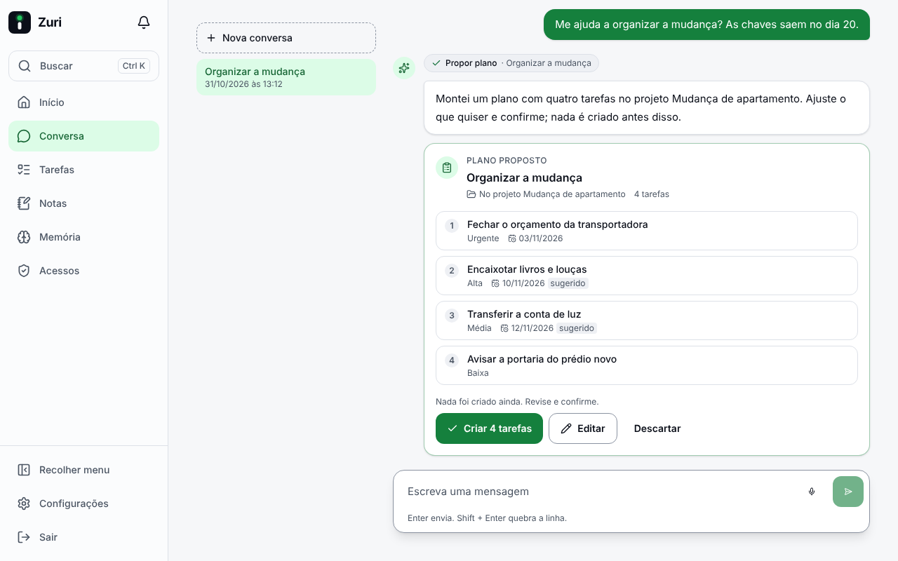
  </picture>
</p>
<p align="center"><b>Conversa</b>: o agente propõe, você confere e confirma</p>

<table>
  <tr>
    <td width="50%" valign="top">
      <picture>
        <source media="(prefers-color-scheme: dark)" srcset="docs/capturas/inicio-computador-escuro.png">
        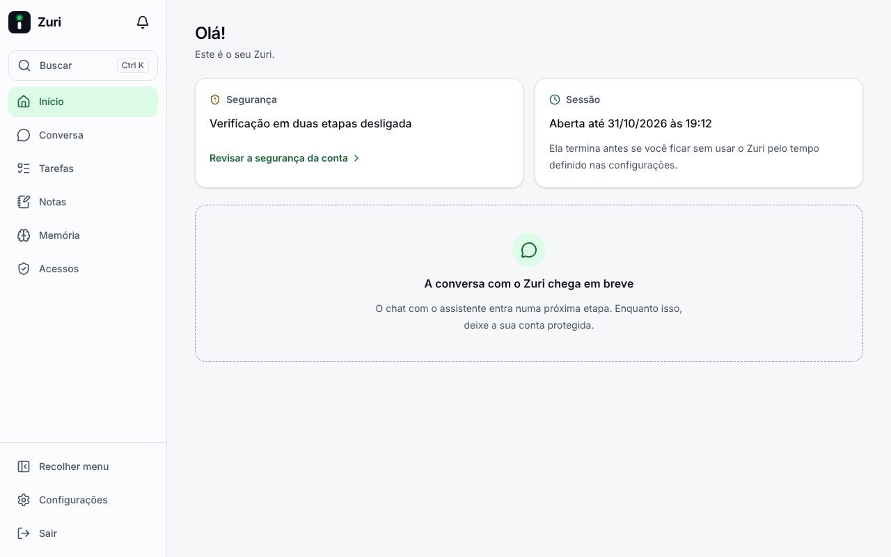
      </picture>
      <p align="center"><b>Início</b>: segurança da conta e sessão num relance</p>
    </td>
    <td width="50%" valign="top">
      <picture>
        <source media="(prefers-color-scheme: dark)" srcset="docs/capturas/tarefas-computador-escuro.png">
        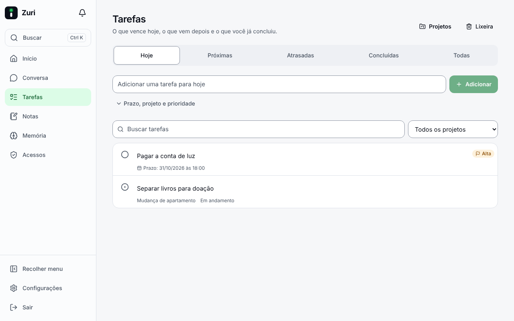
      </picture>
      <p align="center"><b>Tarefas</b>: hoje, próximas, atrasadas, projetos e lixeira</p>
    </td>
  </tr>
  <tr>
    <td width="50%" valign="top">
      <picture>
        <source media="(prefers-color-scheme: dark)" srcset="docs/capturas/nota-computador-escuro.png">
        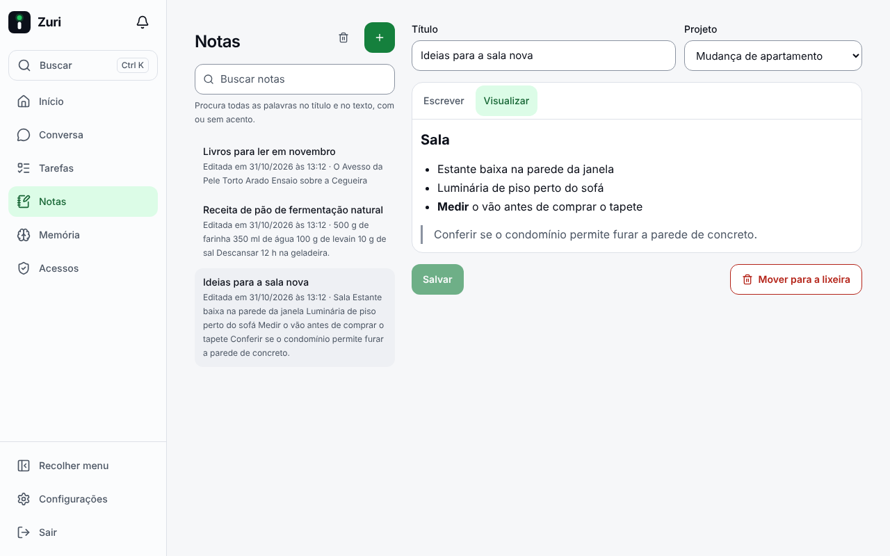
      </picture>
      <p align="center"><b>Notas</b>: Markdown, busca sem acento e projetos</p>
    </td>
    <td width="50%" valign="top">
      <picture>
        <source media="(prefers-color-scheme: dark)" srcset="docs/capturas/memoria-computador-escuro.png">
        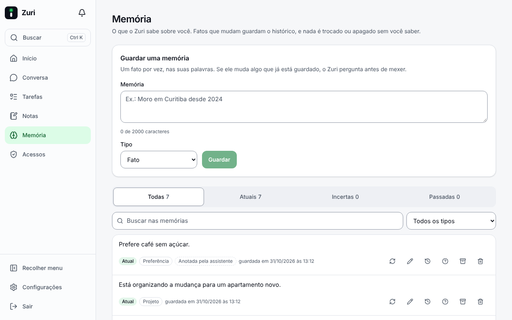
      </picture>
      <p align="center"><b>Memória</b>: o que o Zuri sabe, com histórico</p>
    </td>
  </tr>
  <tr>
    <td width="50%" valign="top">
      <picture>
        <source media="(prefers-color-scheme: dark)" srcset="docs/capturas/entrar-computador-escuro.png">
        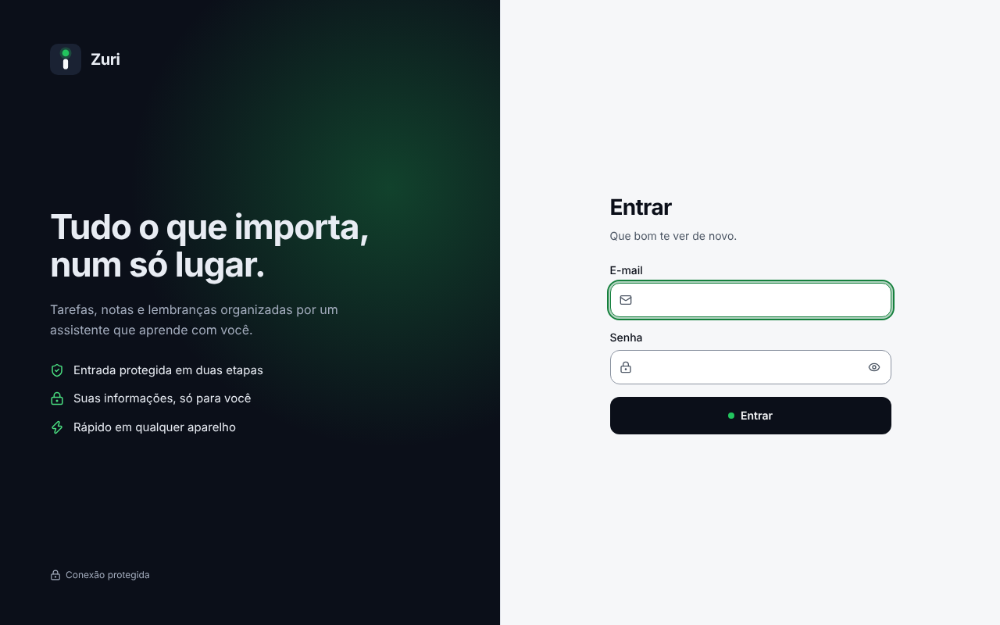
      </picture>
      <p align="center"><b>Entrar</b>: senha, verificação discreta e segundo passo</p>
    </td>
    <td width="50%" valign="top">
      <picture>
        <source media="(prefers-color-scheme: dark)" srcset="docs/capturas/acessos-computador-escuro.png">
        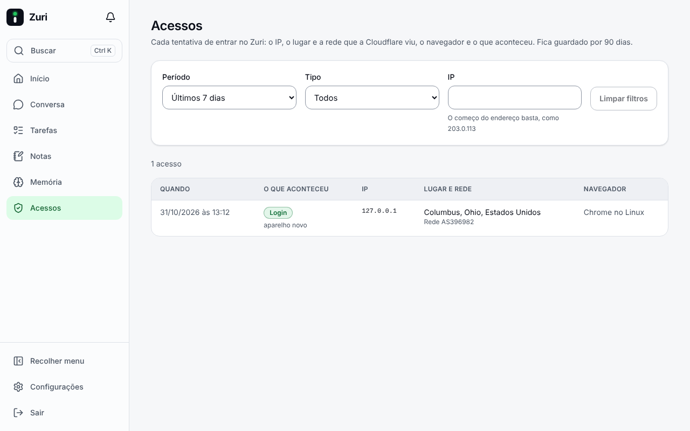
      </picture>
      <p align="center"><b>Acessos</b>: cada tentativa de entrar, com lugar e rede</p>
    </td>
  </tr>
</table>

<details>
<summary><b>No celular</b></summary>
<br>
<p align="center">
  <picture>
    <source media="(prefers-color-scheme: dark)" srcset="docs/capturas/entrar-celular-escuro.png">
    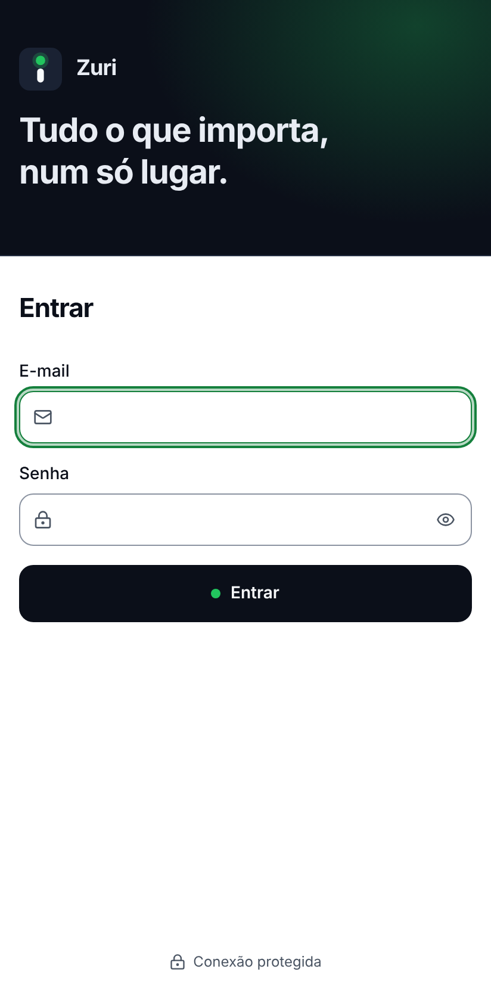
  </picture>
  &nbsp;
  <picture>
    <source media="(prefers-color-scheme: dark)" srcset="docs/capturas/inicio-celular-escuro.png">
    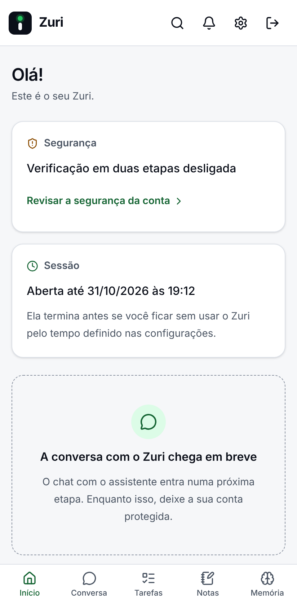
  </picture>
  &nbsp;
  <picture>
    <source media="(prefers-color-scheme: dark)" srcset="docs/capturas/tarefas-celular-escuro.png">
    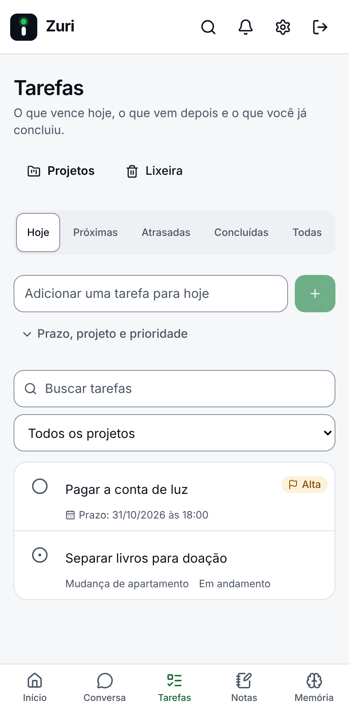
  </picture>
  &nbsp;
  <picture>
    <source media="(prefers-color-scheme: dark)" srcset="docs/capturas/conversa-celular-escuro.png">
    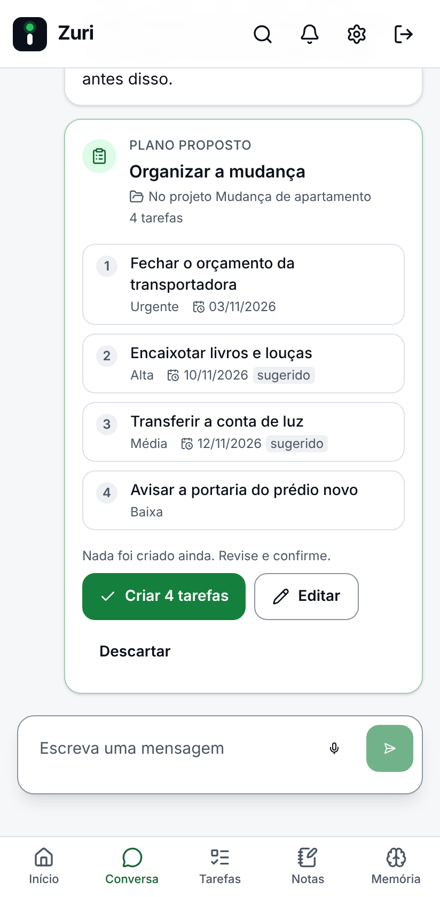
  </picture>
</p>
</details>

## ✅ O que já funciona

O que está na `develop` hoje, etapa por etapa. "extra" marca melhorias feitas fora das etapas.

| | Funcionalidade | O que faz | Etapa |
| :---: | --- | --- | :---: |
| 🛡️ | **Portões de segurança** | Um Worker só, que serve a interface e a API. Toda requisição passa por host permitido, HTTPS, Cloudflare Access opcional, cabeçalhos de segurança e autenticação. | 1 |
| 🌐 | **Idiomas e fuso** | pt-BR por padrão e inglês, datas no padrão brasileiro e fuso `America/Sao_Paulo`. Os erros da API saem no idioma do dono. | 2 |
| 🔑 | **Login e sessões** | Senha forte, sessão que termina por inatividade, proteção contra força bruta e Cloudflare Turnstile em toda tentativa de entrar. | 3 |
| 📱 | **2FA e passkeys** | Aplicativo autenticador (TOTP), 10 códigos de recuperação e passkeys no segundo passo. Ligar o 2FA e criar uma passkey pedem a senha na hora. Alerta a cada 3 códigos errados seguidos; com 30 erros em 24 h, o segundo passo fica suspenso para redes desconhecidas. | 4 |
| 🧭 | **Interface web (PWA)** | Barra lateral recolhível, navegação inferior no celular, tema claro, escuro ou do sistema, instalável no celular e no computador. | 5 |
| ⌨️ | **Paleta de comandos** | Ctrl/⌘ K (ou o botão Buscar) abre a busca de tarefas, notas e memórias e o caminho para qualquer página ou seção das configurações, tudo pelo teclado. | extra |
| 👀 | **Acessos** | Cada tentativa de entrar, com IP, cidade, país, rede, navegador e resultado, filtrável por período e tipo. | extra |
| ✅ | **Tarefas e projetos** | Hoje, próximas, atrasadas e concluídas, com prioridade, prazo no seu fuso e projetos. | 6 |
| 📝 | **Notas** | Markdown seguro, busca de texto completo (com ou sem acento) e lixeira de 30 dias. | 6 |
| 🧠 | **Memória** | Fatos que você guarda, edita e apaga. O que muda vira histórico (atual, incerto ou passado), e conflitos vão para uma fila de revisão. | 7 |
| 📊 | **IA com medição** | Workers AI com contador por chamada e um teto único de 9.000 Neurons por dia, com aviso claro ao chegar nele. | 8 |
| 💬 | **Conversa com ferramentas** | Respostas em tempo real. O agente cria e organiza tarefas, notas e memórias; o que apaga ou reescreve vira um cartão para você aprovar, e planos de tarefas só viram tarefas depois da sua confirmação. Também aceita voz. | 9 |

## 🔭 O que vem a seguir

| | Funcionalidade | O que faz | Etapa |
| :---: | --- | --- | :---: |
| ⏰ | **Automações e avisos** | Lembretes, resumos e rotinas de IA; central de avisos com push, e-mail e prioridade. | 10–11 |
| 🤖 | **Bot do Telegram** | Painel de administração no bolso: consultas sem IA, conversa por texto e voz, aprovações com passkey e modo de bloqueio. | 12–16 |
| 🔌 | **Integrações** | Busca semântica, servidores MCP, Google Agenda, acesso remoto para o n8n e monitor de sites, todos opcionais. | 17–22 |
| 💾 | **Backup e instalação** | Backup e importação, guia de instalação só pelo navegador e auditoria final. | 23–25 |

## 🧭 Como funciona

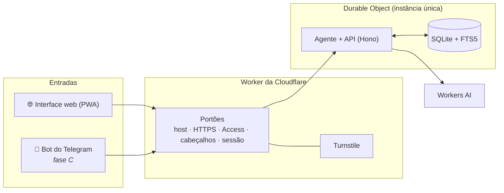

O bot não terá caminho próprio: ele vai passar pelos mesmos portões da interface e chegar ao mesmo agente, aos mesmos dados e aos mesmos limites.

| Camada | Tecnologia |
| --- | --- |
| Worker e API | [Hono](https://hono.dev) sobre Cloudflare Workers |
| Agente e dados | [Agents SDK](https://developers.cloudflare.com/agents/), Durable Object com SQLite e FTS5, migrations só de acréscimo |
| IA | Workers AI; modelos pagos desligados e só com aprovação ⚠️ |
| Interface | React, Vite, Tailwind, TanStack Query e React Router, servida pelo próprio Worker |
| Validação | Zod no servidor e Zod Mini na interface, com os schemas em `packages/shared` |
| Testes | Vitest dentro do workerd, Playwright, axe e Lighthouse |

Mais detalhes em [docs/arquitetura.md](docs/arquitetura.md).

## 🔒 Segurança e privacidade

- **Dono único.** Não há cadastro nem contas de outras pessoas.
- **Login forte.** Senha de 15 caracteres ou mais, Turnstile validado no Worker antes da senha, 2FA, passkeys, códigos de recuperação e defesa contra ataque lento ao segundo passo.
- **Você vê quem tentou.** A página Acessos registra cada tentativa. O IP fica no banco do Zuri e não vai para os logs.
- **Agente com limites.** Sem shell, execução de código, HTTP livre, credenciais ou deploy. Ação destrutiva vira proposta e só roda com a sua aprovação.
- **Conteúdo é dado, nunca instrução.** Notas, memórias, mensagens e resultados de ferramentas entram no modelo em blocos `<data>` neutralizados. Os cenários de injeção de prompt são testados com um modelo que obedece ao texto injetado, e mesmo assim nada é apagado sem você.
- **Segredos só no Worker.** Nada sensível no navegador, no repositório ou nos logs. A CSP da interface é testada na CI.
- **Sem telemetria.** Nenhuma chamada a serviços dos desenvolvedores.

Detalhes em [docs/seguranca.md](docs/seguranca.md). Para relatar uma vulnerabilidade, siga o [SECURITY.md](SECURITY.md) e não abra issue pública.

## 💸 Plano Free, sem surpresa na fatura

| Recurso | Plano Free | Como o Zuri usa |
| --- | :---: | --- |
| Workers, Durable Objects com SQLite | ✅ | Tudo roda aqui, com orçamento por rota medido nos testes |
| Workers AI | ✅ | Teto único de 9.000 Neurons por dia (a cota é 10.000), zerado às 00:00 UTC |
| Turnstile, Email Routing, Cloudflare Access | ✅ | Turnstile no login; os outros são opcionais |
| Modelos pagos (Anthropic, OpenAI) | ⚠️ | Desligados. Só com a sua aprovação e um teto diário em US$ |
| KV, D1, R2, Vectorize, Queues, Workers Paid | ⚠️ | Não usados. Qualquer recurso que gere cobrança exige aprovação explícita |

O orçamento de cada cota está em [docs/arquitetura/orcamento-free-tier.md](docs/arquitetura/orcamento-free-tier.md).

## 🗺️ Mapa das etapas

✅ mesclada · 🚧 em andamento · ⬜ a fazer

| Fase | Etapa | Entrega | Situação |
| --- | :---: | --- | :---: |
| **A · Fundação** | 0 | Repositório, CI, CodeQL e rulesets | ✅ |
| | 1 | Worker, Durable Object e portões | ✅ |
| | 2 | Banco, configurações e i18n | ✅ |
| | 3 | Login e sessões | ✅ |
| | 4 | 2FA e passkeys | ✅ |
| | 5 | Casca da interface e identidade visual | ✅ |
| **B · Assistente na web** | 6 | Tarefas, notas e projetos | ✅ |
| | 7 | Memória e histórico | ✅ |
| | 8 | Provedor de IA e medição de uso | ✅ |
| | 9 | Chat com ferramentas | ✅ |
| | 10 | Automações | ⬜ |
| | 11 | Central de avisos, push e e-mail | ⬜ |
| **C · Bot do Telegram** | 12 | Fundação do bot | ⬜ |
| | 13 | Avisos no Telegram | ⬜ |
| | 14 | Conversa e voz | ⬜ |
| | 15 | Comandos administrativos | ⬜ |
| | 16 | Aprovações seguras e modo de bloqueio | ⬜ |
| **D · Integrações** | 17 | Busca semântica | ⬜ |
| | 18 | Servidores MCP remotos | ⬜ |
| | 19 | Google Agenda | ⬜ |
| | 20 | Acesso remoto e eventos | ⬜ |
| | 21 | Modelos pagos ⚠️ | ⬜ |
| | 22 | Workflows (monitor de sites) | ⬜ |
| **E · Fechamento** | 23 | Backup, importação e retenção | ⬜ |
| | 24 | Deploy e guia de instalação | ⬜ |
| | 25 | Auditoria final e testes de ponta a ponta | ⬜ |

Além das etapas, PRs de melhoria já trouxeram o Turnstile em todo login, a página Acessos, o menu recolhível, a revisão de design e o orçamento de performance. Tudo isso está no [CHANGELOG](CHANGELOG.md).

## 🚀 Rodar localmente

Requer Node.js 24 ou mais novo (a versão fixada está em [`.nvmrc`](.nvmrc)).

```bash
npm ci
npm run dev        # Worker local com IA simulada e a interface
```

Antes do primeiro `npm run dev`, crie o `apps/agent/.dev.vars` com valores locais, como explica [docs/arquitetura.md](docs/arquitetura.md#desenvolvimento-local).

| Comando | Para quê |
| --- | --- |
| `npm run typecheck` | TypeScript em todos os pacotes |
| `npm run lint` | Biome e o lint de textos sem tradução |
| `npm test` | Testes unitários e de integração, dentro do workerd |
| `npm run i18n` | Confere o catálogo em pt-BR e en |
| `npm run test:e2e` | Testes de interface com Playwright |
| `npm run build` | Build da interface e do Worker |

A instalação na sua conta Cloudflare será feita só pelo navegador (fork, segredos e GitHub Actions). O guia chega na etapa 24; até lá, [docs/configuracao-cloudflare.md](docs/configuracao-cloudflare.md) lista os segredos já usados, como as chaves do Turnstile.

## 🧪 Qualidade

Antes de entrar na `develop`, cada etapa passa por:

1. **Testes primeiro.** Todo critério de aceite tem um teste automatizado, ligado a ele numa matriz no PR.
2. **Camadas.** Unitário, integração no workerd, contrato da API, e2e, acessibilidade (axe), i18n e casos de abuso.
3. **Pisos na CI.** Cobertura mínima (99% no agente), Lighthouse 95 ou mais, teste de CSP e um teto para o JS inicial da interface que só pode descer.
4. **QA e auditoria.** Revisão de QA independente e auditoria de segurança em toda etapa, com correção e teste para cada achado.

Estratégia completa em [docs/qa/estrategia-de-testes.md](docs/qa/estrategia-de-testes.md).

## 📁 Estrutura do repositório

```text
apps/
  agent/        Worker, Durable Object, API (e, na fase C, o bot do Telegram)
  web/          Interface React (PWA)
packages/
  shared/       Schemas Zod, constantes, criptografia e catálogo de textos (pt-BR e en)
docs/           Documentação em pt-BR: especificação, arquitetura, QA e capturas
tests/e2e/      Testes de interface com Playwright
scripts/        Lint de i18n, ícones, tamanho do pacote e capturas do README
.claude/        Regras, skills, subagentes e memória do agente de desenvolvimento
```

## 📚 Documentação

| Documento | Assunto |
| --- | --- |
| [Especificação](docs/especificacao.md) | Escopo, contratos e as 26 etapas |
| [Arquitetura](docs/arquitetura.md) | Worker, Durable Object, portões e desenvolvimento local |
| [Segurança](docs/seguranca.md) | Login, sessões, 2FA, passkeys e o modelo de ameaças |
| [Interface](docs/interface.md) | Telas, acessibilidade e a identidade visual Sinal |
| [Produtividade](docs/produtividade.md) | Tarefas, notas, projetos e lixeira |
| [Memória](docs/memoria.md) | Estados, histórico e revisão de conflitos |
| [Configurar a Cloudflare](docs/configuracao-cloudflare.md) | Segredos e Turnstile |
| [Configurar o GitHub](docs/configuracao-github.md) | Rulesets e proteção das branches |

## 🤝 Como contribuir

Leia o [CONTRIBUTING.md](CONTRIBUTING.md) e o [AGENTS.md](AGENTS.md). Em resumo:

- Branch a partir da `develop` e PR sempre para a `develop`. A `main` só recebe releases.
- Título em Conventional Commits, com o texto em pt-BR (`feat(telegram): adiciona o comando /hoje`).
- Testes junto com o código, `CHANGELOG.md` e este README atualizados, e o modelo de PR preenchido.
- Todo texto visível em pt-BR e en, pelo catálogo de i18n.

## 🌎 In English

**Zuri** is a self-hosted, single-owner AI assistant that runs entirely in your own Cloudflare account: one Worker, one Durable Object with SQLite and Workers AI, designed to fit the Free plan. It has a web app (PWA) today and will get a Telegram admin bot in phase C. Sign-in uses Turnstile, TOTP 2FA and passkeys, and the agent has no shell, code execution or open HTTP. It's built in public in 26 steps; steps 0 to 7 are merged. The docs and the UI default to Brazilian Portuguese, and the interface is also available in English.

## 🙌 Créditos e licença

O Zuri é inspirado no [Talorys](https://github.com/pablopfg/talorys), assistente pessoal de IA na Cloudflare, e acrescenta o bot de administração no Telegram. Trechos reaproveitados mantêm o aviso de copyright em [NOTICE.md](NOTICE.md).

Licença [MIT](LICENSE).

<div align="center">
<br>

<br>
<sub>A luz verde quer dizer que o Zuri está trabalhando.</sub>
</div>
