# Capturas da etapa 10 (Automações)

Geradas com `node scripts/capturas-da-interface.ts` e os dados de exemplo de `scripts/dados-de-exemplo.ts`.

## Automações (tela nova)

Com dados de exemplo: rotina esperando aprovação, lembrete diário, resumo em dias úteis, aluguel no dia 31 pausado e histórico.

| | Claro | Escuro |
| --- | --- | --- |
| Computador | 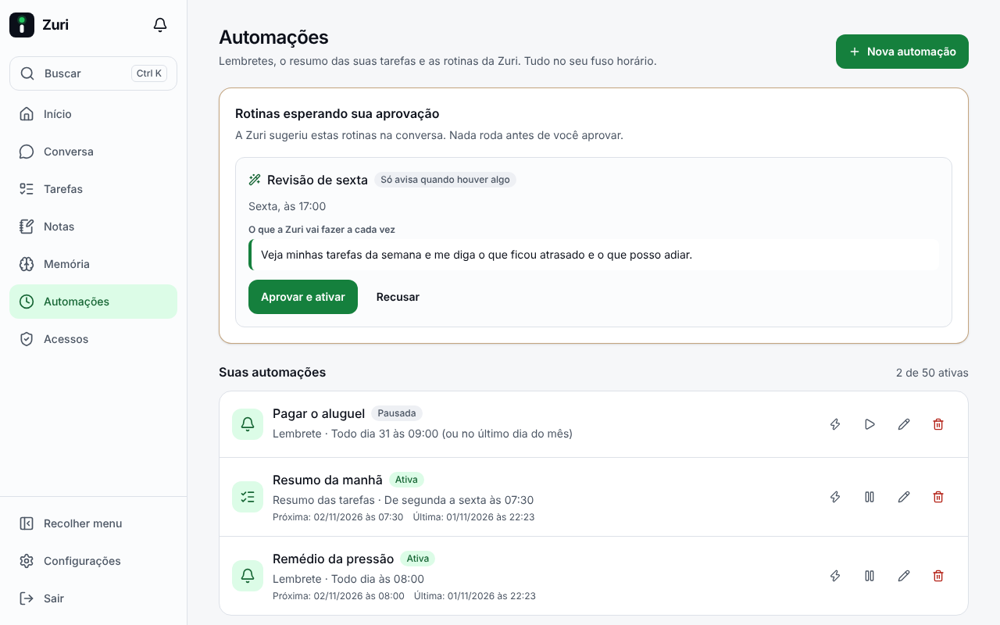 | 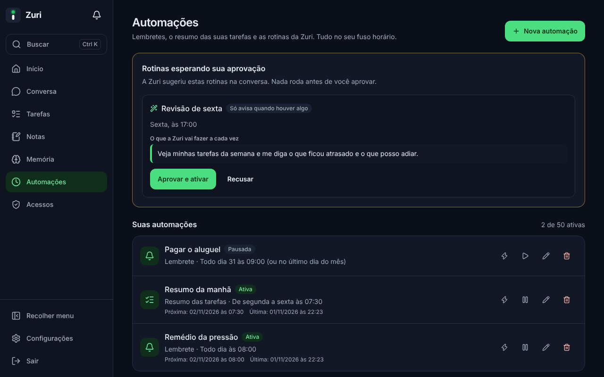 |
| Celular | 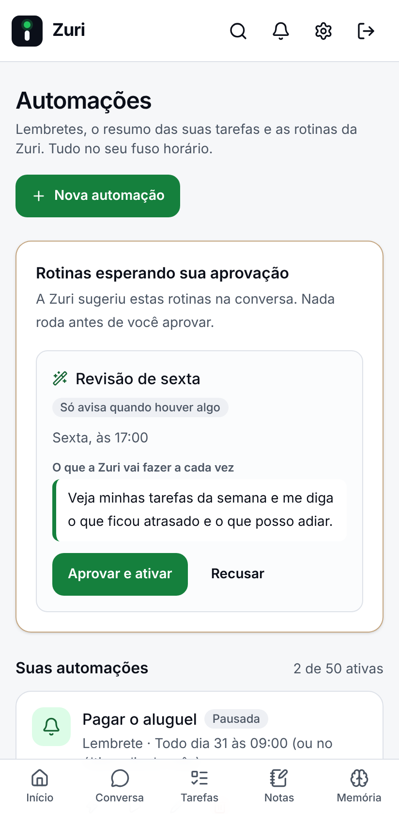 | 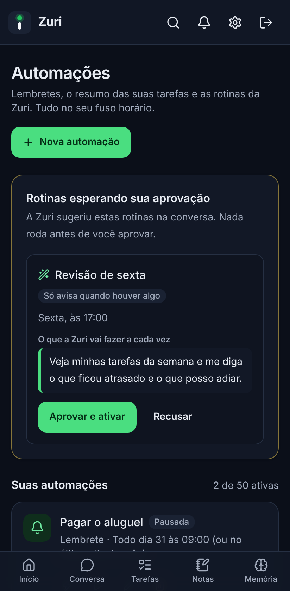 |

## Configurações, antes

No celular, ainda sem atalho para Automações.

| | Claro | Escuro |
| --- | --- | --- |
| Computador | 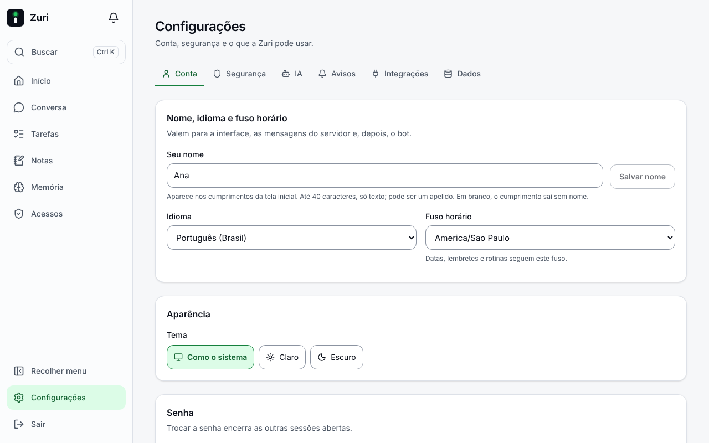 | 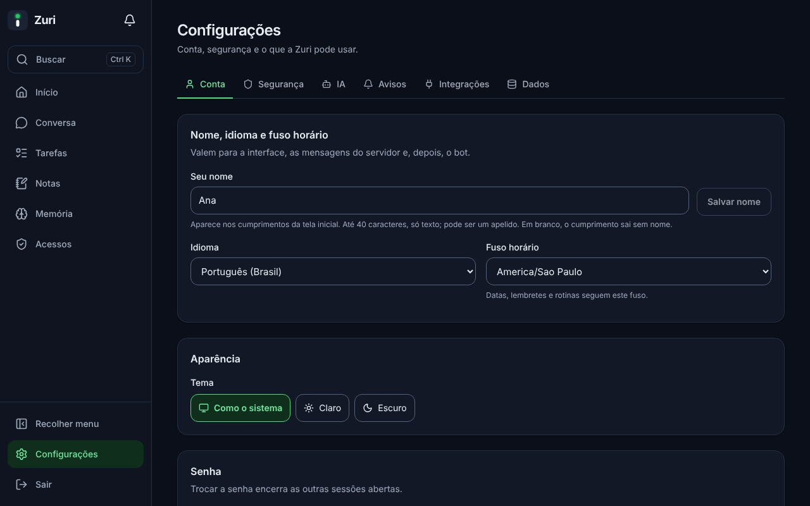 |
| Celular | 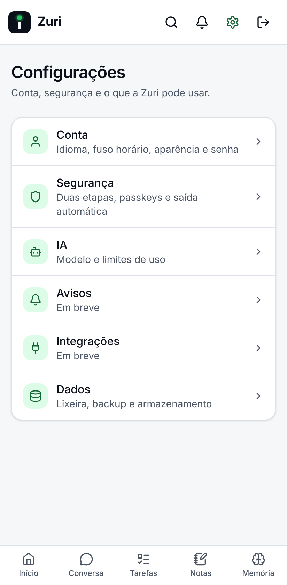 | 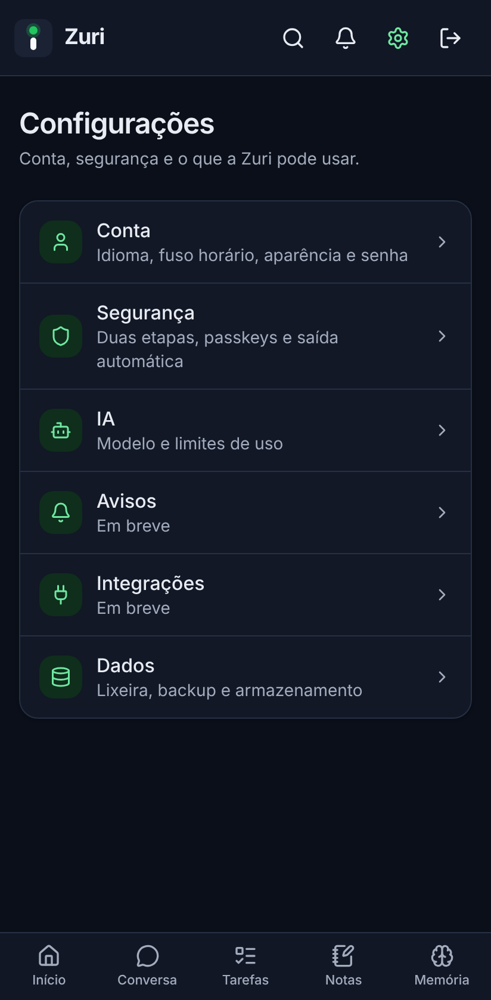 |

## Configurações, depois

No celular, a lista "Outras páginas" com Automações.

| | Claro | Escuro |
| --- | --- | --- |
| Computador | 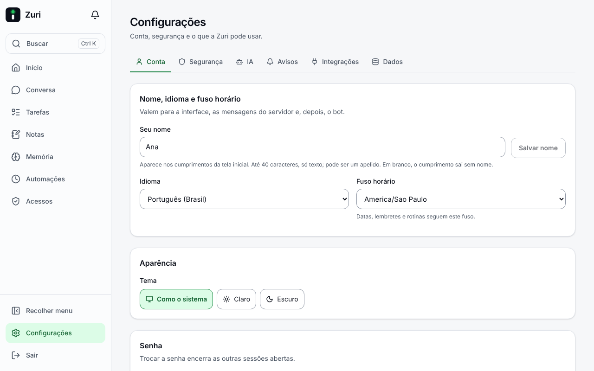 |  |
| Celular | 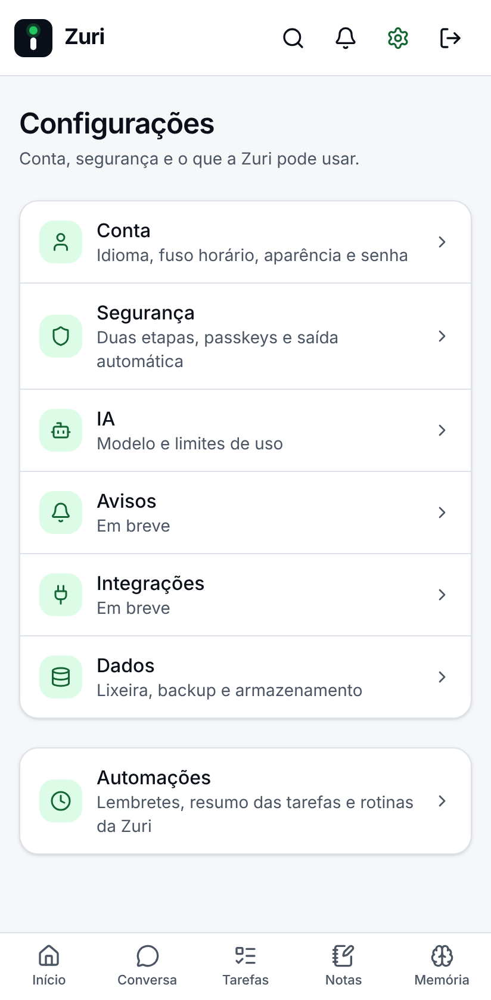 | 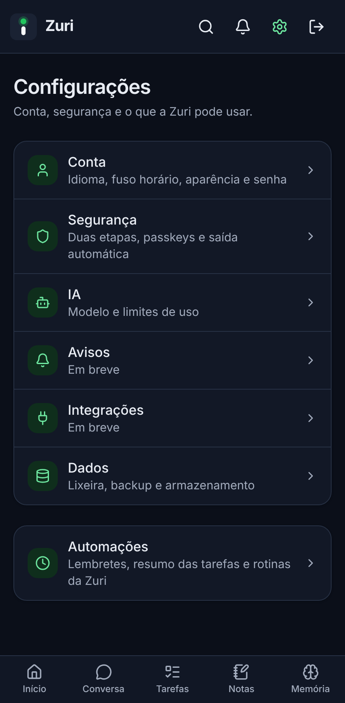 |

## Início, antes

Barra lateral sem Automações.

| | Claro | Escuro |
| --- | --- | --- |
| Computador |  | 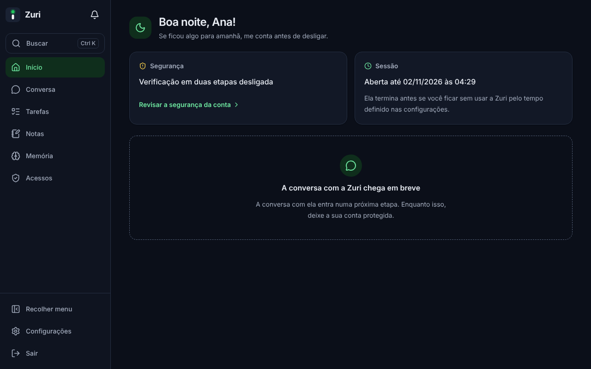 |
| Celular | 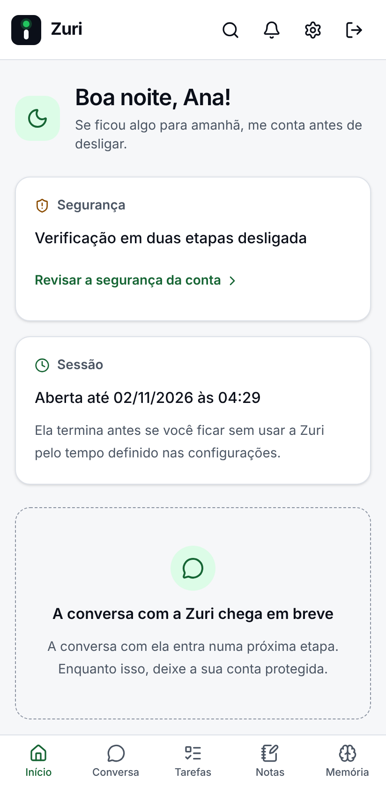 |  |

## Início, depois

Automações na barra lateral.

| | Claro | Escuro |
| --- | --- | --- |
| Computador | 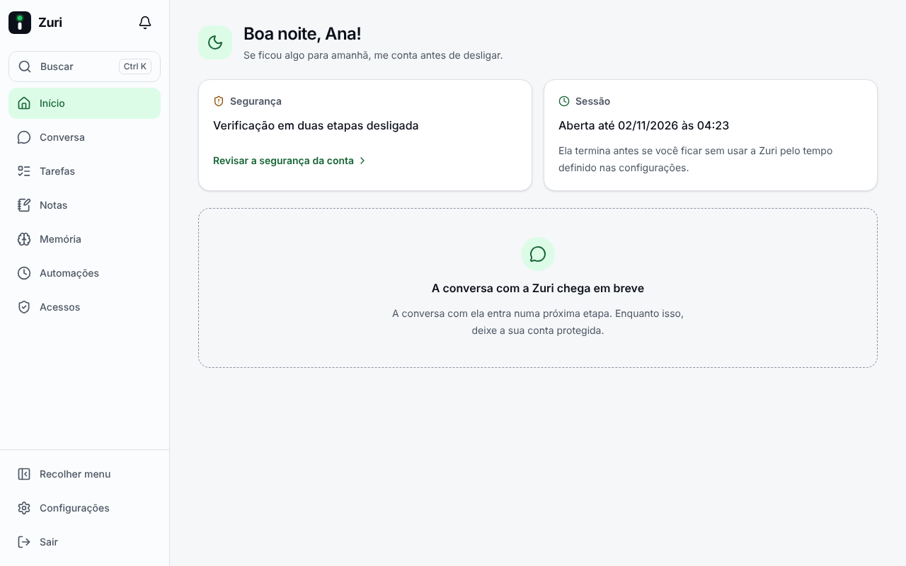 | 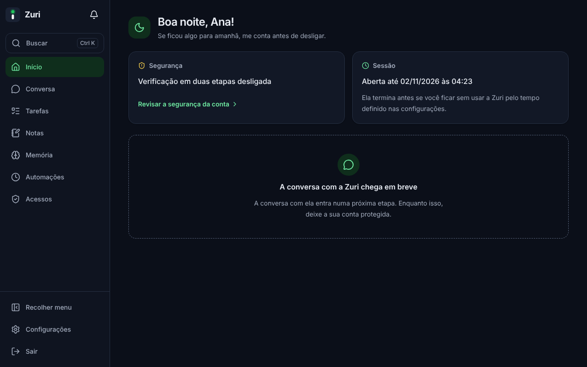 |
| Celular |  | 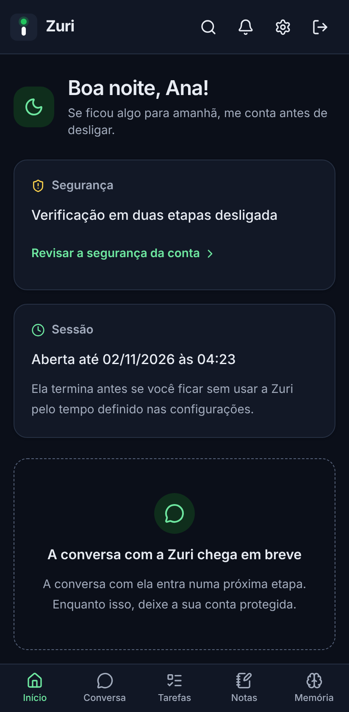 |
